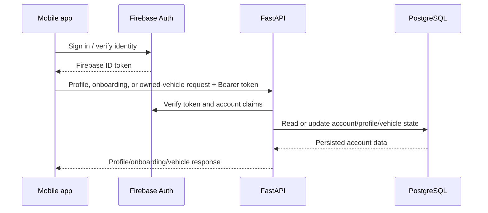
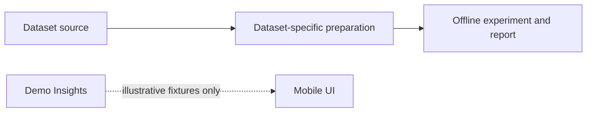
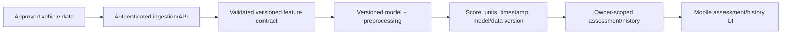

# API and prediction flow

This page separates the flow that exists today from the future model-serving
flow. It is a map of current interfaces, not a claim that model inference is
implemented.

## Implemented account and vehicle flow

The mobile API client obtains a fresh Firebase token and sends it in the
`Authorization: Bearer` header. FastAPI verifies the Firebase identity and uses
the account UID to scope persisted profile, onboarding, and vehicle data. The
mobile app keeps these saved vehicles separate from simulated vehicles and
illustrative Insights values.

## Current model/application boundary

The KIT and Oxford scripts prepare/evaluate datasets offline and produce research
reports and local artifacts. Demo Insights uses illustrative fixtures. It does not
call a model through FastAPI or create an account assessment.
The current app factory registers account/onboarding routes and `/health`;
telemetry, prediction, and report route files are placeholders.

## Future inference flow (not implemented)

Before this flow is built, define the data source and its rights, prediction
target, feature availability at prediction time, vehicle identity, units,
handling for missing/stale input, model validation protocol, response schema,
and persistence/authorization rules. A prediction response should disclose the
model and data versions and must not present an experimental novelty score as a
fault diagnosis or an unconfirmed capacity proxy as dependable RUL.

## Code entry points

- Backend composition and current router registration: `backend/app/main.py`.
- Account routes and auth dependencies: `backend/app/api/routes/` and
  `backend/app/api/deps.py`.
- Mobile HTTP client and Firebase-token use: `mobile/src/api/client.ts`.
- Mobile account vehicle adapter boundary: `mobile/src/api/vehicle-data-provider.ts`.
- Dataset and model experiments: `ml/scripts/`, `ml/src/`, and `ml/reports/`.

The backend and mobile implementations are intentionally left unchanged by this
documentation map.
