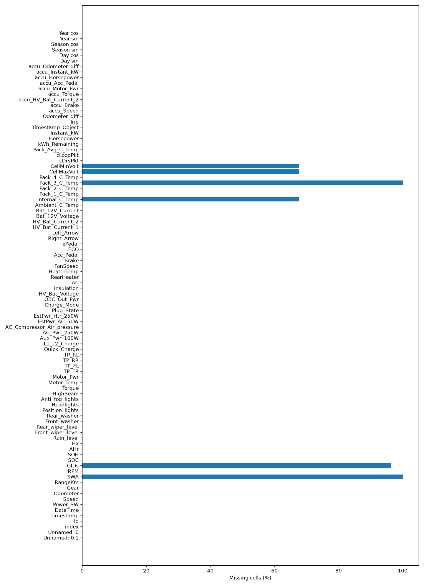
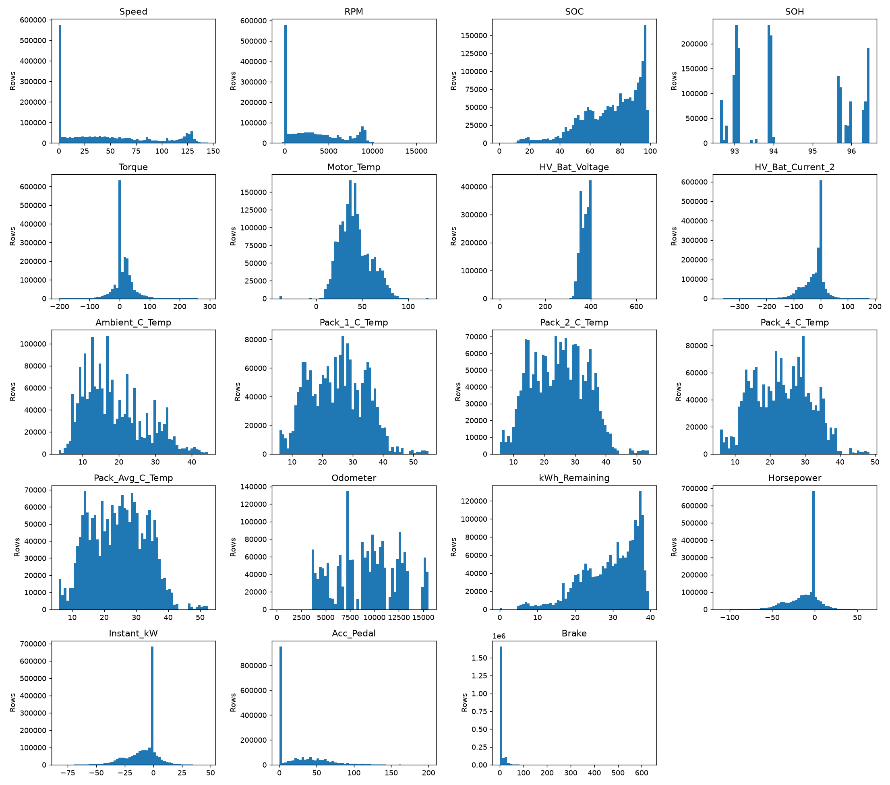
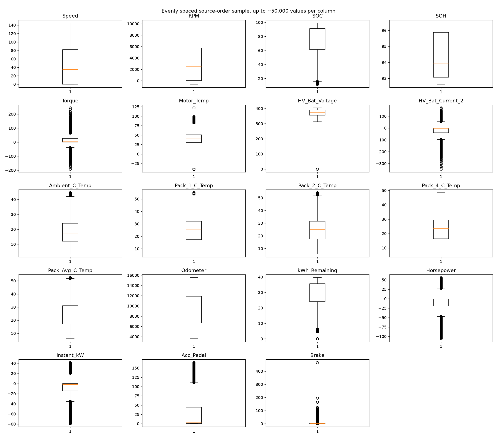
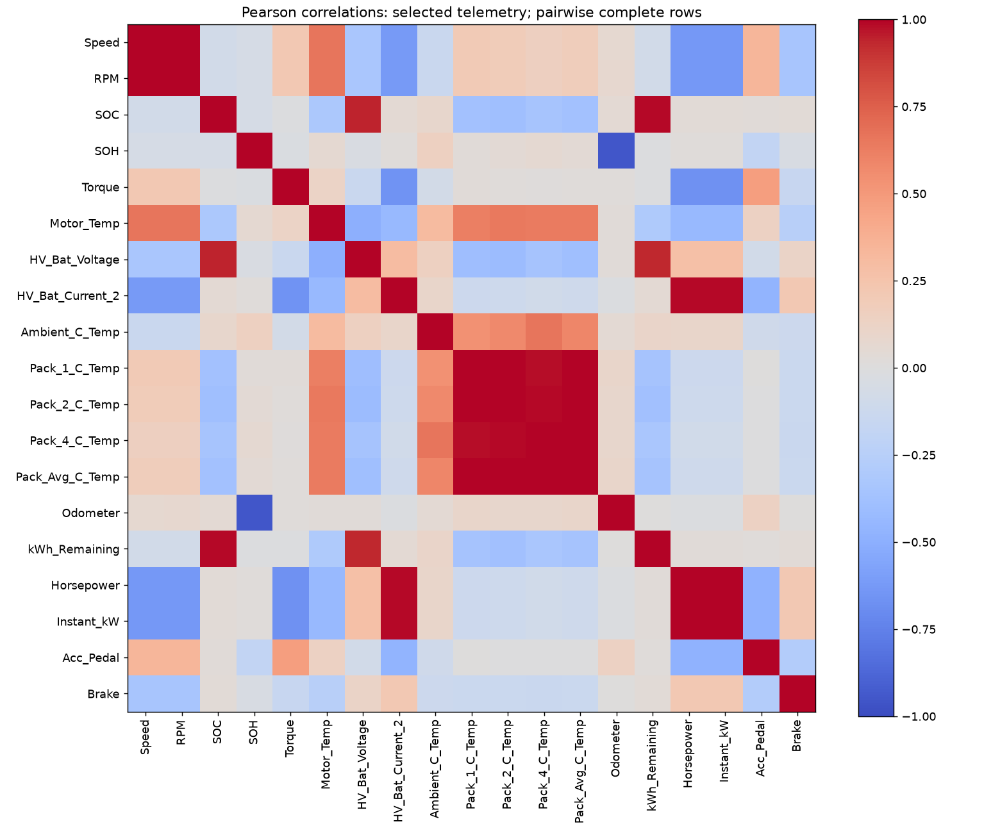
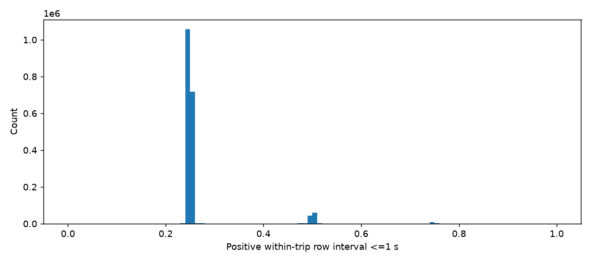
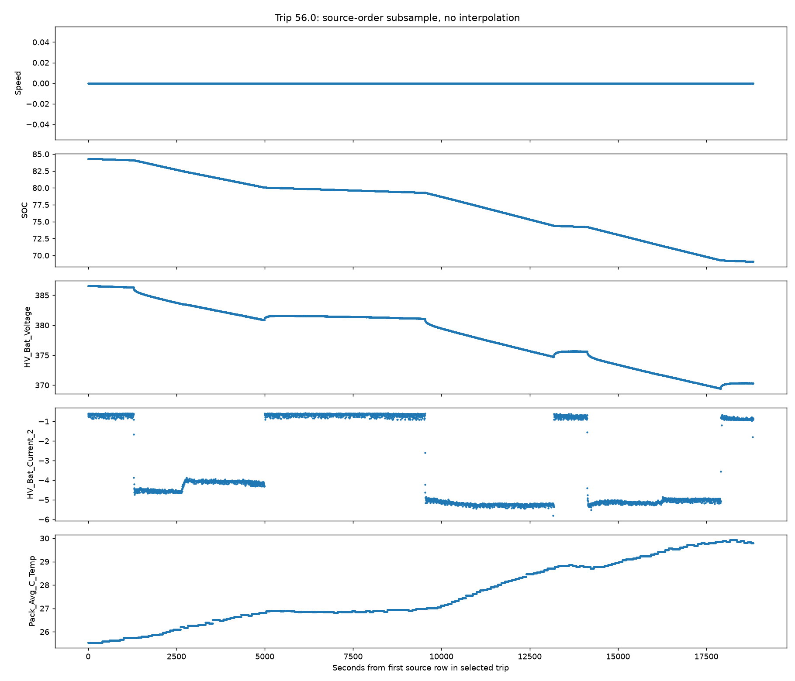
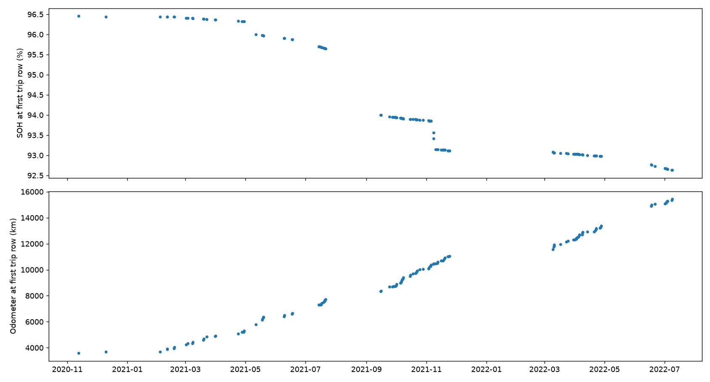

# 2018 Nissan Leaf — complete acquisition, validation and EDA report

**Status: completed on both downloaded CSVs. No model training, feature selection, imputation, deletion or source-file modification was performed.**

Open this file in VS Code and press **Ctrl+Shift+V** to view the tables and plots. The 2018 designation is the vehicle model year, not the year of all recordings.

## 1 — Dataset overview

Source: [UbiLab, Macao Polytechnic University](https://ubilab.mpu.edu.mo/data.html), MPU–UCLA Joint Research Center in Ubiquitous Computing. Both telemetry files and the parameter workbook were downloaded successfully from their official URLs. The preserved source page and workbook are the primary documentation. The official collection description refers to one Nissan Leaf; the CSVs have no VIN or other documented vehicle identifier allowing independent fleet verification.

The website advertises a broader 4.5-million-sample collection covering November 2020–December 2021. The downloaded files have different row counts and extend into 2022; measured file contents take precedence over that description. No semantic release version is given. The telemetry HTTP Last-Modified dates are 2 April 2023; SHA-256 fingerprints below identify this snapshot.

**License:** no explicit dataset license was found in the source page or workbook. Research citation is requested; unrestricted reuse or redistribution is not established. See [sources and rights](metadata/SOURCES.md).

| filename | url | bytes | sha256 |
| --- | --- | --- | --- |
| Dataset_Preprocessed.csv | https://ubilab.mpu.edu.mo/Dataset_Preprocessed.csv | 443747562 | 609efebf1004f5694a1c5af9e3bc56ee11eed2f5b47b07aa736bc701c3918e81 |
| Dataset_NissanLeaf-2021_2022.csv | https://ubilab.mpu.edu.mo/Dataset_NissanLeaf-2021_2022.csv | 1538549900 | 7fe9682e6132ac564eec4928ece989c82d8c9369290abfc00401b7a1c4cdb84c |
| Nissan_Leaf_Model2018_Data_Description.xlsx | https://ubilab.mpu.edu.mo/Nissan_Leaf_Model2018_Data_Description.xlsx | 28139 | 3e2d4d44fbb055108e05d742111cc4ba369a9d0d53742d512214b8cda1429802 |

The CSVs are uncompressed: downloaded and uncompressed sizes are identical. The workbook is a 28,139-byte XLSX ZIP container with 192,845 bytes of uncompressed members. Source-file checksums are local integrity fingerprints, not independently published publisher checksums.

**Access limitation:** the optional monitoring-paper PDF returned HTTP 403 at both institutional direct URLs. No PDF was saved. Its institutional landing page was readable; exact failures and browser access instructions are in [access_log.json](metadata/access_log.json). Dataset downloads succeeded using direct curl after browser-fetch/DNS issues.

## 2 — Dataset dimensions

| Version | Rows | Columns | Numeric storage | Text storage | Numeric measurements/derived (semantic) | Categorical status (numeric-coded) | Timestamp columns | Identifiers/export indices | Fault-label columns | Distinct Trip values | Parsed-data memory bytes |
| --- | --- | --- | --- | --- | --- | --- | --- | --- | --- | --- | --- |
| processed | 1918299 | 32 | 32 | 0 | 26 | 2 | 1 | 3 | 0 | 127 | 491084544 |
| raw | 2322105 | 92 | 90 | 2 | 64 | 20 | 3 | 5 | 0 | 227 | 2017862511 |

Storage datatypes and semantic roles are different classifications. For example ECO is stored numerically but is a status code, and Timestamp is an integer time representation. **These are dataset columns, not a selected ML input-feature set.** No features or prediction target were selected. SOH is an observed ECU health indicator, not verified failure ground truth.

Processed identifiers: `index`, `Driver_ID` (7 distinct codes), `Trip`. Raw identifiers/export fields: the blank header (Pandas alias `Unnamed: 0.1`), `Unnamed: 0`, `index`, `id`, `Trip`. Their full definitions and Driver_ID mapping are not supplied. Trip counts mean supplied IDs, not independently verified uninterrupted sessions; within-trip gaps remain. Raw lacks Driver_ID.

## 3 — Complete column dictionary

Every column is listed below. Dtype lists show types inferred across CSV chunks; all numeric analysis uses float64 disk-backed arrays without rewriting source files. Unknown means the workbook does not establish the definition/unit. Aliases and inferred roles are recorded separately in the CSV dictionaries. The raw file has one blank header and no repeated literal header names; the blank is displayed as `<empty header>` below.

### Processed — all columns

| Original column name | Analysis name | Data type | Description | Unit | Missing % | Unique values |
| --- | --- | --- | --- | --- | --- | --- |
| index | index | int64 | Unknown | Unknown | 0 | 1918299 |
| Timestamp | Timestamp | int64 | Unknown | Unknown | 0 | 1918299 |
| Speed | Speed | float64 | Speed (km/h) from the Leaf ECU | km/h | 0 | 1451 |
| Odometer | Odometer | float64 | Km total | km | 0 | 6892 |
| RPM | RPM | float64 | Motor revolutions per minute | rev/min | 0 | 10497 |
| SOC | SOC | float64 | State of Charge (SOC) of the HV Battery | % | 0 | 583281 |
| SOH | SOH | float64 | State of Health is another indication of the battery's ability to hold and release energy and is reported as a percentage. When the battery is new SOH=100% | % | 0 | 56 |
| Torque | Torque | float64 | Motor Torque. https://www.carwow.co.uk/guides/glossary/what-is-torque (Nm).  Minimum unit step is 0.25 Nm | Nm | 0 | 1505 |
| Motor_Temp | Motor_Temp | float64 | This field is the drive motor temperature | °C | 0 | 592 |
| TP_FR | TP_FR | float64 | Front right tire pressure (in kPa) | kPA | 0 | 56 |
| TP_FL | TP_FL | float64 | Front left tire pressure (in kPa) | kPA | 0 | 54 |
| TP_RR | TP_RR | float64 | Rear right tire pressure (in kPa) | kPA | 0 | 50 |
| TP_RL | TP_RL | float64 | Rear left tire pressure (in kPa) | kPA | 0 | 55 |
| Aux_Pwr_100W | Aux_Pwr_100W | float64 | Power used by the auxiliary equipment (Lights, Radio, Navigation system, rear defroster...) | W | 0 | 11 |
| AC_Pwr_250W | AC_Pwr_250W | float64 | A/C system Power (250W): Power used by the Air Conditioning System power. This includes the power used by the cabin PTC Heater. A/C Compressure Air Pressure(0.1MPa): A/C Compressor high side pressure in Mpa. Multiply by 14.50377 to get PSI.  | W | 0 | 20 |
| EstPwr_AC_50W | EstPwr_AC_50W | float64 | Estimated Air Conditioning System power (COOL) | W | 0 | 70 |
| HV_Bat_Voltage | HV_Bat_Voltage | float64 | High Voltage Battery Voltage (in V) | V | 0 | 10265 |
| Brake | Brake | float64 | Brake pression measured from 0 (not pressed) to 369 (max). Unit?? | Unknown | 0 | 148 |
| Acc_Pedal | Acc_Pedal | float64 | Acceleration pedal pression measured from 0 (not pressed) to 200 (max). Unit?? | Unknown | 0 | 172 |
| ECO | ECO | float64 | ECO mode ON/OFF | 0/1 | 0 | 2 |
| ePedal | ePedal | float64 | ePedal mode ON/OFF https://statics.quattroruote.it/content/dam/quattroruote/it/news/novita/2017/07/20/nuova_nissan_leaf_debutta_il_nuovo_e_pedal/gallery/rsmall/2017-epedal.jpg | 0/1 | 0 | 2 |
| HV_Bat_Current_2 | HV_Bat_Current_2 | float64 | High Voltage Battery Amperage (positive=from battery (driving), negative when regeneration or charging) | A | 0 | 95609 |
| Ambient_C_Temp | Ambient_C_Temp | float64 | Ambient temperature comes from the Leaf's outside temperature sensor and is saved in degrees Fahrenheit. This value is only valid when the Leaf is ON (not ACC mode and not when charging) | Unknown: workbook unit says °C; description says Fahrenheit | 0 | 93 |
| Pack_1_C_Temp | Pack_1_C_Temp | float64 | HV Battery temperature sensors (Pack_1_C_Temp, Pack_2_C_Temp, Pack_3_C_Temp, Pack_4_C_Temp). On Leaf 2018 40kW, Pack 3 is missing | °C | 0 | 6917 |
| Pack_2_C_Temp | Pack_2_C_Temp | float64 | HV Battery temperature sensors (Pack_1_C_Temp, Pack_2_C_Temp, Pack_3_C_Temp, Pack_4_C_Temp). On Leaf 2018 40kW, Pack 3 is missing | °C | 0 | 8077 |
| Pack_4_C_Temp | Pack_4_C_Temp | float64 | HV Battery temperature sensors (Pack_1_C_Temp, Pack_2_C_Temp, Pack_3_C_Temp, Pack_4_C_Temp). On Leaf 2018 40kW, Pack 3 is missing | °C | 0 | 7489 |
| Pack_Avg_C_Temp | Pack_Avg_C_Temp | float64 | Unknown | Unknown | 0 | 10477 |
| kWh_Remaining | kWh_Remaining | float64 | Unknown | Unknown | 0 | 1309555 |
| Horsepower | Horsepower | float64 | Derived from battery voltage × current, not a measured mechanical output | Unknown: formula gives 1.341 × kW | 0 | 1525671 |
| Instant_kW | Instant_kW | float64 | Battery electrical power from voltage × current / 1000 | kW | 0 | 1525649 |
| Driver_ID | Driver_ID | int64 | Unknown | Unknown | 0 | 7 |
| Trip | Trip | int64 | Unknown | Unknown | 0 | 127 |

### Raw — all columns

| Original column name | Analysis name | Data type | Description | Unit | Missing % | Unique values |
| --- | --- | --- | --- | --- | --- | --- |
| <empty header> | Unnamed: 0.1 | int64 | Unknown | Unknown | 0 | 2322105 |
| Unnamed: 0 | Unnamed: 0 | int64 | Unknown | Unknown | 0 | 2322105 |
| index | index | int64 | Unknown | Unknown | 0 | 2322105 |
| id | id | int64 | Unknown | Unknown | 0 | 2322105 |
| Timestamp | Timestamp | int64 | Unknown | Unknown | 0 | 2322105 |
| DateTime | DateTime | object | Unknown | Unknown | 0 | 2322105 |
| Power_SW | Power_SW | int64 | This field will be True if Power Switch is ON otherwise it will be False | 0/1 | 0 | 1 |
| Speed | Speed | float64 | Speed (km/h) from the Leaf ECU | km/h | 0 | 1452 |
| Odometer | Odometer | float64 | Km total | km | 0 | 8030 |
| Gear | Gear | int64 | Gear position (0=not read yet, 1=Park, 2=Reverse, 3=Neutral, 4=Drive, 7=B/Eco) | see Info | 0 | 8 |
| RangeKm | RangeKm | int64 | Remaining km to turtle mode | km | 0 | 308 |
| SWA | SWA | float64 | Steering Wheel angle The angle ranges from -720 to 720 degrees with negative being left turn. | ° (360°) | 100 | 0 |
| RPM | RPM | int64 | Motor revolutions per minute | rev/min | 0 | 10516 |
| GIDs | GIDs | float64 | Gids which indicates the energy in the Leaf battery. Nissan multiplies this value by 80 Wh to get current capacity of the HV Battery | --- | 96.36485 | 91 |
| SOC | SOC | float64 | State of Charge (SOC) of the HV Battery | % | 0 | 617149 |
| SOH | SOH | float64 | State of Health is another indication of the battery's ability to hold and release energy and is reported as a percentage. When the battery is new SOH=100% | % | 0.09676565 | 84 |
| AHr | AHr | float64 | Capacity of HV Battery. This is how much energy the battery could hold when fully charged. You can get an estimate of energy currently in the battery by multiplying SOC% times AHr times 360 volts (nominal HV battery voltage) = WHr | Ah | 0 | 47 |
| Hx | Hx | float64 | This is an indication of the HV Battery's health. A value of 100 would be a battery in factory new condition. The number is thought to be an indication of battery internal resistance with 100 indicating a new battery with lowest resistance. As the value decreases the internal resistance is increasing. As the internal resistance increases more energy is wasted as heat inside the battery instead of powering the Leaf | % | 0 | 664 |
| Rain_level | Rain_level | float64 | Rain sensitivity level for front wiper (automatic mode) (1: low, 4: high) | see Info | 0 | 5 |
| Front_wiper_level | Front_wiper_level | float64 | -1: Off; 0: Automatic; 1: Continous slow speed; 2: Continous high speed | see Info | 0 | 4 |
| Rear_wiper_level | Rear_wiper_level | float64 | -1: Off; 1: Intermittent; 2: Continous low speed | see Info | 0 | 1 |
| Front_washer | Front_washer | float64 | -1: Not active; 1: Active | see Info | 0 | 2 |
| Rear_washer | Rear_washer | float64 | -1: Not active; 1: Active | see Info | 0 | 1 |
| Position_lights | Position_lights | int64 | -1: Off; 0: Automatic mode; 1: On | see Info | 0 | 2 |
| Headlights | Headlights | int64 | -1: Off; 0: Automatic mode; 1: On | see Info | 0 | 3 |
| Anti_fog_lights | Anti_fog_lights | int64 | -1: Off; 1: On | see Info | 0 | 2 |
| HighBeam | HighBeam | int64 | -1: Off; 0: Automatic mode; 1: On; 2: Manual | see Info | 0 | 4 |
| Torque | Torque | float64 | Motor Torque. https://www.carwow.co.uk/guides/glossary/what-is-torque (Nm).  Minimum unit step is 0.25 Nm | Nm | 0 | 1713 |
| Motor_Temp | Motor_Temp | int64 | This field is the drive motor temperature | °C | 0 | 98 |
| Motor_Pwr | Motor_Pwr | int64 | Drive motor power in watt units | W | 0 | 1914 |
| TP_FR | TP_FR | float64 | Front right tire pressure (in kPa) | kPA | 0 | 58 |
| TP_FL | TP_FL | float64 | Front left tire pressure (in kPa) | kPA | 0 | 55 |
| TP_RR | TP_RR | float64 | Rear right tire pressure (in kPa) | kPA | 0 | 54 |
| TP_RL | TP_RL | float64 | Rear left tire pressure (in kPa) | kPA | 0 | 59 |
| Quick_Charge | Quick_Charge | float64 | Number of Quick Charges. Each time a Quick Charge occurs this number increments by 1 | --- | 0 | 21 |
| L1_L2_Charge | L1_L2_Charge | float64 | Number of L1/L2 connections and charges. This number increases each time the J1772 charge cord is plugged into the Leaf. It also increases by one for each delayed charge that takes place. If the Leaf charge timer is not active, so charging starts immediately when the charge cord is plugged in, then the count will increase by only one. But if the timer is active then the count will increase by two. Once when the charge cord is initially plugged in and a second time when the timer starts the delayed charge. | --- | 0 | 107 |
| Aux_Pwr_100W | Aux_Pwr_100W | int64 | Power used by the auxiliary equipment (Lights, Radio, Navigation system, rear defroster...) | W | 0 | 13 |
| AC_Pwr_250W | AC_Pwr_250W | int64 | A/C system Power (250W): Power used by the Air Conditioning System power. This includes the power used by the cabin PTC Heater. A/C Compressure Air Pressure(0.1MPa): A/C Compressor high side pressure in Mpa. Multiply by 14.50377 to get PSI.  | W | 0 | 22 |
| AC_Compressor_Air_pressure | AC_Compressor_Air_pressure | int64 | A/C system Power (250W): Power used by the Air Conditioning System power. This includes the power used by the cabin PTC Heater. A/C Compressure Air Pressure(0.1MPa): A/C Compressor high side pressure in Mpa. Multiply by 14.50377 to get PSI.  | MPa | 0 | 3 |
| EstPwr_AC_50W | EstPwr_AC_50W | int64 | Estimated Air Conditioning System power (COOL) | W | 0 | 94 |
| EstPwr_Htr_250W | EstPwr_Htr_250W | int64 | Estimated Cabin PTC Heater power (HEAT) | W | 0 | 17 |
| Plug_State | Plug_State | int64 | Plug state of J1772 (L1/L2) charge port ( 0=Not plugged, 1=Partial Plugged, 2=Plugged ) | see Info | 0 | 2 |
| Charge_Mode | Charge_Mode | int64 | Charging mode. ( 0=Not charging, 1=Level 1 charging (100-120 volts), 2=Level 2 charging (200-240 volts),  3=Level 3 Quick Charging ) | see Info | 0 | 2 |
| OBC_Out_Pwr | OBC_Out_Pwr | int64 | Charging power coming into the Leaf in watts (W) | W | 0 | 13 |
| HV_Bat_Voltage | HV_Bat_Voltage | float64 | High Voltage Battery Voltage (in V) | V | 0 | 8889 |
| Insulation | Insulation | float64 | Unknown | Unknown | 0 | 221 |
| AC | AC | int64 | Unknown | 0/1 | 0 | 20 |
| RearHeater | RearHeater | int64 | Unknown | 0/1 | 0 | 1 |
| HeaterTemp | HeaterTemp | float64 | Heater temperature from 16.5°C to 30°C set by the driver | °C | 0.00030145062 | 29 |
| FanSpeed | FanSpeed | float64 | Fan speed from 0 (off) to 8 (max) | 0-8 | 0 | 18 |
| Brake | Brake | int64 | Brake pression measured from 0 (not pressed) to 369 (max). Unit?? | Unknown | 0 | 275 |
| Acc_Pedal | Acc_Pedal | int64 | Acceleration pedal pression measured from 0 (not pressed) to 200 (max). Unit?? | Unknown | 0 | 192 |
| ECO | ECO | int64 | ECO mode ON/OFF | 0/1 | 0 | 3 |
| ePedal | ePedal | int64 | ePedal mode ON/OFF https://statics.quattroruote.it/content/dam/quattroruote/it/news/novita/2017/07/20/nuova_nissan_leaf_debutta_il_nuovo_e_pedal/gallery/rsmall/2017-epedal.jpg | 0/1 | 0 | 3 |
| Right_Arrow | Right_Arrow | float64 | -1: Off; 1: Active | see Info | 0 | 2 |
| Left_Arrow | Left_Arrow | float64 | -1: Off; 1: Active | see Info | 0 | 2 |
| HV_Bat_Current_1 | HV_Bat_Current_1 | float64 | High Voltage Battery Amperage (positive=from battery (driving), negative when regeneration or charging) | A | 0 | 4754 |
| HV_Bat_Current_2 | HV_Bat_Current_2 | float64 | High Voltage Battery Amperage (positive=from battery (driving), negative when regeneration or charging) | A | 0 | 87986 |
| Bat_12V_Voltage | Bat_12V_Voltage | float64 | The voltage of the 12 volt battery as read by the Leaf's Vehicle Control Module ECU | V | 0 | 40 |
| Bat_12V_Current | Bat_12V_Current | float64 | 12 volt battery current. Minus is drain and positive is charging. | A | 0 | 9349 |
| Ambient_C_Temp | Ambient_C_Temp | float64 | Ambient temperature comes from the Leaf's outside temperature sensor and is saved in degrees Fahrenheit. This value is only valid when the Leaf is ON (not ACC mode and not when charging) | Unknown: workbook unit says °C; description says Fahrenheit | 0 | 85 |
| Internal_C_Temp | Internal_C_Temp | float64 | Unknown | Unknown | 67.621189 | 38 |
| Pack_1_C_Temp | Pack_1_C_Temp | float64 | HV Battery temperature sensors (Pack_1_C_Temp, Pack_2_C_Temp, Pack_3_C_Temp, Pack_4_C_Temp). On Leaf 2018 40kW, Pack 3 is missing | °C | 0 | 612 |
| Pack_2_C_Temp | Pack_2_C_Temp | float64 | HV Battery temperature sensors (Pack_1_C_Temp, Pack_2_C_Temp, Pack_3_C_Temp, Pack_4_C_Temp). On Leaf 2018 40kW, Pack 3 is missing | °C | 0 | 604 |
| Pack_3_C_Temp | Pack_3_C_Temp | float64 | HV Battery temperature sensors (Pack_1_C_Temp, Pack_2_C_Temp, Pack_3_C_Temp, Pack_4_C_Temp). On Leaf 2018 40kW, Pack 3 is missing | °C | 100 | 0 |
| Pack_4_C_Temp | Pack_4_C_Temp | float64 | HV Battery temperature sensors (Pack_1_C_Temp, Pack_2_C_Temp, Pack_3_C_Temp, Pack_4_C_Temp). On Leaf 2018 40kW, Pack 3 is missing | °C | 0 | 578 |
| CellMaxVolt | CellMaxVolt | float64 | Unknown | Unknown | 67.618992 | 694 |
| CellMinVolt | CellMinVolt | float64 | Unknown | Unknown | 67.618992 | 975 |
| cDrvPkt | cDrvPkt | float64 | Unknown | Unknown | 0.021532187 | 32388 |
| cLoopPkt | cLoopPkt | float64 | Unknown | Unknown | 0.021532187 | 401 |
| Pack_Avg_C_Temp | Pack_Avg_C_Temp | float64 | Unknown | Unknown | 0 | 2879 |
| kWh_Remaining | kWh_Remaining | float64 | Unknown | Unknown | 0 | 1584406 |
| Horsepower | Horsepower | float64 | Derived from battery voltage × current, not a measured mechanical output | Unknown: formula gives 1.341 × kW | 0 | 1805716 |
| Instant_kW | Instant_kW | float64 | Battery electrical power from voltage × current / 1000 | kW | 0 | 1805693 |
| Timestamp_Object | Timestamp_Object | object | Unknown | Unknown | 0 | 641664 |
| Trip | Trip | int64 | Unknown | Unknown | 0 | 227 |
| Odometer_diff | Odometer_diff | float64 | Unknown | Unknown | 0 | 66 |
| accu_Speed | accu_Speed | float64 | Unknown | Unknown | 0 | 1454892 |
| accu_Brake | accu_Brake | int64 | Unknown | Unknown | 0 | 232087 |
| accu_HV_Bat_Current_2 | accu_HV_Bat_Current_2 | float64 | Unknown | Unknown | 0 | 2312746 |
| accu_Torque | accu_Torque | float64 | Unknown | Unknown | 0 | 919367 |
| accu_Motor_Pwr | accu_Motor_Pwr | int64 | Unknown | Unknown | 0 | 1024768 |
| accu_Acc_Pedal | accu_Acc_Pedal | int64 | Unknown | Unknown | 0 | 572976 |
| accu_Horsepower | accu_Horsepower | float64 | Unknown | Unknown | 0 | 2318951 |
| accu_Instant_kW | accu_Instant_kW | float64 | Unknown | Unknown | 0 | 2318951 |
| accu_Odometer_diff | accu_Odometer_diff | float64 | Unknown | Unknown | 0 | 2422 |
| Day sin | Day sin | float64 | Unknown | Unknown | 0 | 2322038 |
| Day cos | Day cos | float64 | Unknown | Unknown | 0 | 2322105 |
| Season sin | Season sin | float64 | Unknown | Unknown | 0 | 2322105 |
| Season cos | Season cos | float64 | Unknown | Unknown | 0 | 2322105 |
| Year sin | Year sin | float64 | Unknown | Unknown | 0 | 2322105 |
| Year cos | Year cos | float64 | Unknown | Unknown | 0 | 2322086 |

`Pack_Avg_C_Temp`, `kWh_Remaining`, `Driver_ID`, `Trip`, accumulated fields and calendar encodings are not fully defined under those exact names in the workbook. The formulas examined below provide evidence for some derived relationships, not complete metadata. Battery-cell extrema names alone do not establish their scale.

## 4 — Data quality

| Version | Missing cells | Missing cells % | All-empty columns | Constant nonmissing columns | Exact full-row duplicates | Duplicate epoch timestamps | Repeated measurement rows |
| --- | --- | --- | --- | --- | --- | --- | --- |
| processed | 0 | 0 | None | None | 0 | 0 | 35953 |
| raw | 11595760 | 5.4278712 | SWA, Pack_3_C_Temp | Power_SW, Rear_wiper_level, Rear_washer, RearHeater | 0 | 0 | 13733 |

Repeated-measurement counts exclude timestamps, IDs and derived variables and use each version’s own available measurement set; they are **not directly comparable counts over identical columns**. Repeated readings can be normal because sensors are polled at different intervals or the vehicle state stays constant. No duplicates were deleted. Full-row duplicate screening uses hashes, with candidate rows confirmed against original records; numeric measurement candidates are confirmed elementwise including missingness. No identical trip-sequence hashes or overlapping trip time ranges were found. This screen does not prove independence or exclude partly copied sessions.

Near-constant means at least 99% of nonmissing values are identical. Raw near-constant columns (including constants): `Power_SW`, `Rear_wiper_level`, `Front_washer`, `Rear_washer`, `AC_Compressor_Air_pressure`, `Plug_State`, `RearHeater`, `Right_Arrow`, `Left_Arrow`, `Odometer_diff`. Processed has none under that rule.

### Raw missingness and consecutive runs

| column | missing_count | missing_pct | missing_runs | longest_missing_run_rows | longest_missing_span_seconds |
| --- | --- | --- | --- | --- | --- |
| SWA | 2322105 | 100 | 16052 | 52412 | 14097.001 |
| GIDs | 2237693 | 96.36485 | 14963 | 31986 | 8654.2439 |
| SOH | 2247 | 0.09676565 | 14 | 1024 | 258.2503 |
| HeaterTemp | 7 | 0.00030145062 | 1 | 7 | 1.493846 |
| Internal_C_Temp | 1570235 | 67.621189 | 4015 | 52412 | 14097.001 |
| Pack_3_C_Temp | 2322105 | 100 | 16052 | 52412 | 14097.001 |
| CellMaxVolt | 1570184 | 67.618992 | 3989 | 52412 | 14097.001 |
| CellMinVolt | 1570184 | 67.618992 | 3989 | 52412 | 14097.001 |
| cDrvPkt | 500 | 0.021532187 | 2 | 278 | 78.99813 |
| cLoopPkt | 500 | 0.021532187 | 2 | 278 | 78.99813 |

Missingness uses Pandas CSV NA parsing. Runs are broken at trip changes, timestamp reversals/repeats and gaps >1 second; reported duration is first-to-last observed timestamp, not an inferred period with no packets. `missing_patterns.csv` lists every observed co-missing pattern. The workbook explicitly states Pack 3 is absent on this model variant; not every empty column is a broken sensor.

### Processed observations requiring attention

| severity | column | rule | count | interpretation |
| --- | --- | --- | --- | --- |
| requires_investigation | TP_FR | zero_pressure_or_voltage | 200532 | Possible unavailable-value code; context needed |
| requires_investigation | TP_FL | zero_pressure_or_voltage | 201260 | Possible unavailable-value code; context needed |
| requires_investigation | TP_RR | zero_pressure_or_voltage | 201934 | Possible unavailable-value code; context needed |
| requires_investigation | TP_RL | zero_pressure_or_voltage | 197301 | Possible unavailable-value code; context needed |
| requires_investigation | HV_Bat_Voltage | zero_pressure_or_voltage | 2 | Possible unavailable-value code; context needed |
| documentation_uncertainty | Brake | unknown_units | 1918299 | Workbook explicitly questions units; do not call this percent |
| documentation_uncertainty | Acc_Pedal | unknown_units | 1918299 | Workbook explicitly questions units; do not call this percent |
| documentation_conflict | Ambient_C_Temp | unit_conflict | 1918299 | Workbook unit is Celsius but prose says Fahrenheit; no conversion applied |
| requires_investigation | Timestamp | within_trip_gap_over_1s | 7984 | Heuristic four nominal row intervals; not proof packets were lost |
| requires_investigation | Odometer | odometer_decrease_within_trip | 321 | Cumulative distance moves backwards within a trip; reset, decoding or recording error requires investigation |
| requires_investigation | Odometer | odometer_jump_over_1km_within_1s | 304 | Change inconsistent with ordinary road motion; retained for review |
| requires_investigation | HV_Bat_Voltage | voltage_over_500V_review_screen | 1 | Exploratory threshold for nominal-360V documentation; not a manufacturer limit or fault label |

### Raw observations requiring attention

| severity | column | rule | count | interpretation |
| --- | --- | --- | --- | --- |
| definite_schema_issue | header | empty_column_name | 1 | Pandas supplies an Unnamed alias; original header is preserved in dictionary |
| data_availability | Power_SW | constant | 2322105 | No within-file variation; may be legitimate status |
| requires_investigation | Speed | negative_nonnegative_quantity | 266235 | Possible invalid/unavailable-value code; no automatic replacement |
| requires_investigation | Odometer | negative_nonnegative_quantity | 83431 | Possible invalid/unavailable-value code; no automatic replacement |
| data_availability | SWA | all_missing | 2322105 | No observed values; preserved |
| requires_investigation | SOC | outside_0_100_percent | 2040 | Outside documented percentage scale; not a verified fault |
| data_availability | Rear_wiper_level | constant | 2322105 | No within-file variation; may be legitimate status |
| data_availability | Rear_washer | constant | 2322105 | No within-file variation; may be legitimate status |
| requires_investigation | TP_FR | negative_nonnegative_quantity | 183069 | Possible invalid/unavailable-value code; no automatic replacement |
| requires_investigation | TP_FR | zero_pressure_or_voltage | 244965 | Possible unavailable-value code; context needed |
| requires_investigation | TP_FL | negative_nonnegative_quantity | 183067 | Possible invalid/unavailable-value code; no automatic replacement |
| requires_investigation | TP_FL | zero_pressure_or_voltage | 247981 | Possible unavailable-value code; context needed |
| requires_investigation | TP_RR | negative_nonnegative_quantity | 183067 | Possible invalid/unavailable-value code; no automatic replacement |
| requires_investigation | TP_RR | zero_pressure_or_voltage | 251321 | Possible unavailable-value code; context needed |
| requires_investigation | TP_RL | negative_nonnegative_quantity | 183067 | Possible invalid/unavailable-value code; no automatic replacement |
| requires_investigation | TP_RL | zero_pressure_or_voltage | 242018 | Possible unavailable-value code; context needed |
| requires_investigation | HV_Bat_Voltage | negative_nonnegative_quantity | 2134 | Possible invalid/unavailable-value code; no automatic replacement |
| requires_investigation | HV_Bat_Voltage | zero_pressure_or_voltage | 5 | Possible unavailable-value code; context needed |
| requires_investigation | AC | outside_documented_binary_codes | 707240 | Retained; may be an undocumented unavailable code |
| requires_investigation | RearHeater | outside_documented_binary_codes | 2322105 | Retained; may be an undocumented unavailable code |
| data_availability | RearHeater | constant | 2322105 | No within-file variation; may be legitimate status |
| documentation_uncertainty | Brake | unknown_units | 2322105 | Workbook explicitly questions units; do not call this percent |
| documentation_uncertainty | Acc_Pedal | unknown_units | 2322105 | Workbook explicitly questions units; do not call this percent |
| requires_investigation | ECO | outside_documented_binary_codes | 149899 | Retained; may be an undocumented unavailable code |
| requires_investigation | ePedal | outside_documented_binary_codes | 83339 | Retained; may be an undocumented unavailable code |
| documentation_conflict | Ambient_C_Temp | unit_conflict | 2322105 | Workbook unit is Celsius but prose says Fahrenheit; no conversion applied |
| documented_unavailable | Pack_3_C_Temp | all_missing | 2322105 | Workbook states pack 3 sensor absent on this Leaf variant |
| data_availability | Pack_3_C_Temp | all_missing | 2322105 | No observed values; preserved |
| requires_investigation | Timestamp | within_trip_gap_over_1s | 15825 | Heuristic four nominal row intervals; not proof packets were lost |
| requires_investigation | Odometer | odometer_decrease_within_trip | 202 | Cumulative distance moves backwards within a trip; reset, decoding or recording error requires investigation |
| requires_investigation | Odometer | odometer_jump_over_1km_within_1s | 190 | Change inconsistent with ordinary road motion; retained for review |
| requires_investigation | HV_Bat_Voltage | voltage_over_500V_review_screen | 2 | Exploratory threshold for nominal-360V documentation; not a manufacturer limit or fault label |

Statistical outliers use values outside Q1 − 1.5×IQR or Q3 + 1.5×IQR on all finite rows, per numeric measurement/derived column. They are screening observations, **not invalid-value or fault labels**. With zero IQR every deviation can be flagged; categorical codes, timestamps and IDs are excluded from outlier interpretation. Full counts and fences are in each summary table. Zero/negative pressure, invalid binary codes and odometer discontinuities are investigated separately. No blanket −1 replacement is valid: the workbook defines −1 as “off” for multiple controls, while −1 in speed/pressure is suspicious. No unsupported universal 999 sentinel rule was applied.



## 5 — Statistical findings

The per-version `summary_statistics.csv` files contain count, finite count, mean, median, sample standard deviation and variance (ddof=1), extrema, quartiles, 1st/5th/95th/99th percentiles, unique counts and skewness where more than two distinct finite values exist. IDs and numeric timestamps are retained for completeness but not treated as physical sensors. No infinite nonmissing values or failed numeric conversions were detected in this run; see integrity tables.

### Selected preprocessed measurements

| column | mean | median | std_ddof1 | min | max | skewness | iqr_outlier_count |
| --- | --- | --- | --- | --- | --- | --- | --- |
| Speed | 46.165959 | 35 | 45.460547 | 0 | 145 | 0.59736806 | 0 |
| Odometer | 9217.4604 | 9431 | 3213.639 | 255 | 15537 | 0.011429153 | 0 |
| RPM | 3233.9333 | 2460 | 3182.2528 | -620 | 16383 | 0.59557773 | 16 |
| SOC | 74.724675 | 78.9901 | 19.157933 | 0.3198 | 99.1054 | -0.86180964 | 11777 |
| SOH | 94.408724 | 93.91 | 1.3835138 | 92.63 | 96.46 | 0.32199882 | 0 |
| HV_Bat_Voltage | 373.31395 | 374.95 | 19.6785 | 0 | 655.35 | -0.23723334 | 3 |
| HV_Bat_Current_2 | -22.474795 | -5.5947266 | 38.485198 | -370.66895 | 179.65918 | -1.3178354 | 107231 |
| Ambient_C_Temp | 18.651393 | 17 | 8.28976 | 3.5 | 44.5 | 0.68177459 | 5051 |
| Pack_Avg_C_Temp | 24.389005 | 24.7 | 8.6557062 | 5.8333333 | 52.466667 | 0.09295713 | 1592 |




Histograms use all finite observations. Separate `all_numeric_distributions_*.png` pages cover every numeric measurement/derived column, including those not in the overview plot. Boxplots use deterministic evenly spaced source-order samples (about 50,000 values per column) and are labelled as such; the numerical outlier counts remain full-data counts. Repeated/quantized signals, long tails and spikes are visible; none was removed.

### Correlations

Pearson matrices use 19 selected varying telemetry/derived columns and pairwise complete observations over all rows. Export IDs, timestamps, arbitrary accumulated/calendar fields and status codes are not included. Strong pairs mean |r| ≥ 0.8; sample counts are provided. No causal conclusion follows from these associations, and temporal dependence weakens any independent-sample interpretation.

| column_a | column_b | pearson_r | pairwise_observations |
| --- | --- | --- | --- |
| Horsepower | Instant_kW | 1 | 1918299 |
| Speed | RPM | 0.99958028 | 1918299 |
| Pack_2_C_Temp | Pack_Avg_C_Temp | 0.99907915 | 1918299 |
| Pack_1_C_Temp | Pack_Avg_C_Temp | 0.99529955 | 1918299 |
| Pack_1_C_Temp | Pack_2_C_Temp | 0.993984 | 1918299 |
| Pack_4_C_Temp | Pack_Avg_C_Temp | 0.99358996 | 1918299 |
| Pack_2_C_Temp | Pack_4_C_Temp | 0.99145087 | 1918299 |
| SOC | kWh_Remaining | 0.99100729 | 1918299 |
| HV_Bat_Current_2 | Horsepower | 0.98941264 | 1918299 |
| HV_Bat_Current_2 | Instant_kW | 0.98941264 | 1918299 |
| Pack_1_C_Temp | Pack_4_C_Temp | 0.9787701 | 1918299 |
| SOH | Odometer | -0.95080593 | 1918299 |
| SOC | HV_Bat_Voltage | 0.94225463 | 1918299 |
| HV_Bat_Voltage | kWh_Remaining | 0.93361143 | 1918299 |



Horsepower and Instant_kW are deterministically related. Pack temperatures and their derived average overlap strongly; speed/RPM correlation reflects coupled vehicle motion. SOH/odometer association can reflect shared elapsed use and does not establish the cause of battery degradation.

### Time-series characteristics

| Version | Earliest (UTC interpretation) | Latest | Calendar span days | Median within-trip positive delta s | Within-trip gaps >1s | Largest within-trip positive gap s | Reversals | Sum of positive within-trip intervals <=1s, hours |
| --- | --- | --- | --- | --- | --- | --- | --- | --- |
| processed | 2020-11-12 13:01:08.757376+00:00 | 2022-07-08 17:55:20.001000+00:00 | 603.2043 | 0.25 | 7984 | 3526.2044 | 0 | 141.91108 |
| raw | 2020-11-12 13:01:08.257560+00:00 | 2022-08-03 17:19:57.501000+00:00 | 629.17974 | 0.25 | 15825 | 3635.5007 | 0 | 173.77686 |

Calendar span is not continuous recording duration. The interval sum is an explicitly bounded coverage proxy, not exact driving time. The smallest positive interval is 2 microseconds in both files, despite a median of 250 ms. Trip boundary and gap records are retained; no sorting, interpolation or resampling was done.

Timestamp is interpreted as Unix microseconds. Raw DateTime uses day-month-year text with fractional seconds; Timestamp_Object uses ISO-like UTC text at second resolution. All parse successfully. DateTime can differ from the microsecond epoch by up to 9 microseconds. Timestamp_Object differs by up to 0.999767 seconds and has only 641,664 distinct instants, so it must not replace the full-resolution Timestamp as a unique row key. Its repeated values reflect coarser precision, not duplicate telemetry rows.

The workbook documents 250 ms battery group polling, 1 s speed/RPM/torque, and 10 s or 100 s for several slower fields. Value-change frequency (`measurement_updates.csv`) cannot prove sensor refresh rate because true values can remain constant.




## 6 — Vehicle telemetry findings

Available in both files: speed, motor RPM/torque/temperature, odometer, SOC, SOH, HV voltage/current, three pack temperatures, tire pressures, auxiliary/AC power, brake and accelerator signals, ECO/ePedal status, and derived power/energy/temperature fields. Raw additionally provides AHr, Hx, 12 V battery voltage/current, charge counters/modes, plug state and cabin controls, with varying data quality. Complete ranges, meanings and units are in the dictionary and statistics tables.

| column | count | min | median | max | unique_values |
| --- | --- | --- | --- | --- | --- |
| AHr | 2322105 | -1 | 108 | 111 | 47 |
| Hx | 2322105 | -1 | 83.82 | 639.99 | 664 |
| Quick_Charge | 2322105 | 0 | 1 | 29 | 21 |
| L1_L2_Charge | 2322105 | 122 | 215 | 33022 | 107 |
| OBC_Out_Pwr | 2322105 | -1 | 0 | 6000 | 13 |
| Bat_12V_Voltage | 2322105 | -1 | 13.04 | 14.56 | 40 |
| Bat_12V_Current | 2322105 | -77 | -0.07 | 74.81 | 9349 |
| CellMaxVolt | 751921 | -1 | 4044 | 65282 | 694 |
| CellMinVolt | 751921 | -1 | 3763 | 6528 | 975 |

### Charging and sign conventions

| Charge_Mode | rows | speed_min | speed_max | current_min | current_max | SOC_min | SOC_max | OBC_min | OBC_max |
| --- | --- | --- | --- | --- | --- | --- | --- | --- | --- |
| -1 | 605817 | -1 | 143 | -378.867 | 960.7666 | -1 | 98.6149 | -1 | 6000 |
| 0 | 1716288 | -1 | 145 | -377.17773 | 854.69 | -1 | 99.269 | -1 | 6000 |

Charge_Mode contains only 0 (documented not charging) and −1 (undocumented). There are no documented active-charge codes 1/2/3 in this download. That does not prove charging never occurred: OBC power has inconsistent nonzero values, and unavailable/stale codes are possible. Charge counters describe historical connections, not complete charging-event records. The workbook says HV current is positive for discharge and negative for regeneration/charging, but negative current dominates even among moving rows; polarity/acquisition consistency needs researcher confirmation. Do not identify charging events from current sign alone.

| condition | rows | interpretation |
| --- | --- | --- |
| negative_current_moving | 1125558 | Current sign per workbook; regeneration/charging cannot be distinguished from sign alone |
| negative_current_stationary | 516786 | Current sign per workbook; regeneration/charging cannot be distinguished from sign alone |
| positive_current | 273842 | Current sign per workbook; regeneration/charging cannot be distinguished from sign alone |
| zero_current | 2113 | Current sign per workbook; regeneration/charging cannot be distinguished from sign alone |

### Derived-field consistency

**Processed**

| relationship | compared_rows | max_abs_error | mean_abs_error | rows_close_atol_1e-8_rtol_1e-8 |
| --- | --- | --- | --- | --- |
| Instant_kW_from_VI | 1918299 | 121.06626 | 0.11727382 | 1888242 |
| Horsepower_from_Instant_kW | 1918299 | 4.2632564e-14 | 6.6904177e-16 | 1918299 |
| Pack_Avg_from_1_2_4 | 1918299 | 4.7333333 | 0.00065411701 | 1916904 |

**Raw**

| relationship | compared_rows | max_abs_error | mean_abs_error | rows_close_atol_1e-8_rtol_1e-8 |
| --- | --- | --- | --- | --- |
| Instant_kW_from_VI | 2322105 | 2.8421709e-14 | 2.5600065e-16 | 2322105 |
| Horsepower_from_Instant_kW | 2322105 | 5.6843419e-14 | 6.0852573e-16 | 2322105 |
| Pack_Avg_from_1_2_4 | 2322105 | 7.1054274e-15 | 7.2262191e-16 | 2322105 |

All three tested relationships hold within tolerance in raw. In processed, 30,057 power rows differ from voltage×current/1000 and 1,395 average-temperature rows differ from the mean of pack sensors 1/2/4. Horsepower remains 1.341×Instant_kW. This is consistent with component/derived fields being transformed differently, but the exact preprocessing cause is unverified. “Horsepower” here derives from battery electrical power; it is not independently measured wheel or shaft output.



The first and last processed trip rows report SOH 96.46% and 92.63% (a 3.83 percentage-point change), with odometer 3,578 to 15,537 km. Odometer anomalies mean rowwise distance differences cannot all be trusted. SOH is a reported battery estimate with repeated/quantized values; the observed trajectory is not a controlled capacity test or maintenance-confirmed degradation record.

## 7 — Labels and limitations

No verified healthy/faulty labels, confirmed failure events, DTC columns, maintenance/repair histories or ground-truth component diagnoses appear in these CSVs or the downloaded dictionary. SOC/SOH and operating states are observations, not fault labels. No task-specific target is designated.

The publisher describes one vehicle and the data supplies 7 driver codes only in processed; these do not imply 7 vehicles. No VIN/battery serial column is present despite such parameters being mentioned in the general workbook. Driver identities, route selection, excluded sessions, logging gaps, release history and exact preprocessing rules are not fully documented. Single-vehicle observational sampling, non-continuous recordings, selected trips and unknown exclusion criteria limit generalization. Statistical outliers cannot establish real faults.

## 8 — Raw versus preprocessed data

| Comparison | Value |
| --- | --- |
| matched_unique_index_rows | 1886696 |
| raw_only_index_rows | 435409 |
| processed_only_index_rows | 31603 |
| same_timestamp_at_matched_index | 1886696 |

Independent exact timestamp matching gives **1,886,696 shared rows**, **435,409 raw-only timestamps**, and **31,603 processed-only timestamps**. All shared timestamps have matching indices. The unmatched processed records occur across 63 trip IDs. Therefore, the downloaded processed file is **not a strict subset** of the downloaded raw file. This does not prove researchers fabricated records; release differences or unprovided processing inputs remain possible. No nearest-time matching was used.

Raw has 92 columns and 227 Trip values; processed has 32 and 127. Driver_ID is processed-only; 61 raw columns are absent from processed. Raw already contains export indices, trip IDs, derived and accumulated/calendar fields, so “raw” is the publisher’s label, not evidence of an untouched CAN dump.

| column | matched_rows | numerically_changed_rtol_atol_1e-9 | raw_minus1_processed_zero | max_abs_change_finite |
| --- | --- | --- | --- | --- |
| AC_Pwr_250W | 1886696 | 454 | 14 | 1500 |
| Acc_Pedal | 1886696 | 12959 | 103 | 200 |
| Ambient_C_Temp | 1886696 | 1046 | 0 | 28.5 |
| Aux_Pwr_100W | 1886696 | 2431 | 36 | 400 |
| Brake | 1886696 | 24407 | 7 | 45299 |
| ECO | 1886696 | 1592 | 114 | 1 |
| EstPwr_AC_50W | 1886696 | 1120 | 0 | 1600 |
| HV_Bat_Current_2 | 1886696 | 17908 | 0 | 972.92733 |
| HV_Bat_Voltage | 1886696 | 2475 | 0 | 403.6 |
| Horsepower | 1886696 | 26504 | 0 | 492.90191 |
| Instant_kW | 1886696 | 26504 | 0 | 367.56295 |
| Motor_Temp | 1886696 | 404 | 0 | 85 |
| Pack_1_C_Temp | 1886696 | 525 | 0 | 23.199488 |
| Pack_2_C_Temp | 1886696 | 613 | 0 | 23.79821 |
| Pack_4_C_Temp | 1886696 | 525 | 0 | 21.70021 |
| Pack_Avg_C_Temp | 1886696 | 525 | 0 | 22.899303 |
| RPM | 1886696 | 2323 | 211 | 32519 |
| SOC | 1886696 | 905 | 0 | 96.1924 |
| SOH | 1886696 | 128 | 0 | 0.07 |
| Speed | 1886696 | 1711 | 101 | 128 |
| TP_FL | 1886696 | 1346 | 104 | 304 |
| TP_FR | 1886696 | 1346 | 90 | 440 |
| TP_RL | 1886696 | 1344 | 90 | 297 |
| TP_RR | 1886696 | 1346 | 104 | 294 |
| Torque | 1886696 | 25709 | 116 | 407.98438 |
| ePedal | 1886696 | 7022 | 0 | 1 |
| kWh_Remaining | 1886696 | 7 | 0 | 36.795849 |

The comparison uses numeric closeness with absolute and relative tolerances of 1e-9 and reports every shared column in the supporting CSV. Odometer is unchanged on matched rows, so preprocessing did not resolve its observed discontinuities there. Some −1 readings become zero, including tire pressure. Zero missingness partly reflects a reduced column set; it does not establish that every missing field was imputed. Distribution changes also reflect row selection and cannot all be attributed to cleaning. No release-specific executable preprocessing recipe was obtained or reproduced.

Full comparisons: [per-column distributions](tables/raw_processed_distributions.csv), [matching values](tables/raw_processed_matched_values.csv), [retained versus absent raw rows](tables/retained_vs_removed_raw_rows.csv), [timestamp alignment](tables/raw_processed_timestamp_alignment.json).

## 9 — Overall EDA conclusions

**Strengths:** official research provenance, substantial real-world telemetry, useful battery and vehicle channels, a parameter workbook, explicit trip codes, available raw/preprocessed versions, and a long observed SOH/odometer history.

**Most important limitations:** no verified diagnostic labels or maintenance history; one-vehicle scope; coverage/count mismatch with the landing-page description; raw/processed release mismatch; time gaps; missing raw channels; suspicious pressure, voltage and odometer values; uncertain units/current polarity; and derived-field inconsistencies after preprocessing. Absence of missing values in processed does not resolve these concerns.

**Before choosing ML tasks**, obtain the exact preprocessing code and input release, definitions for every undocumented column and driver/trip assignment, confirmed units/current sign and unavailable-value codes, trustworthy charging/maintenance/failure records, intended usage rights, and independent vehicle/session data. No model architecture or algorithm is selected by this report.

### Reproduction and verification

Run from the repository root using the existing virtual environment:

```bash
.venv/bin/python ml/notebooks/nissan_leaf_2018/scripts/acquire.py
MPLCONFIGDIR=/tmp/drivepulse-matplotlib .venv/bin/python ml/notebooks/nissan_leaf_2018/scripts/run_eda.py
.venv/bin/python ml/notebooks/nissan_leaf_2018/scripts/validate.py
.venv/bin/python ml/notebooks/nissan_leaf_2018/scripts/build_report.py
```

Existing downloads are checked and reused. Source-size changes cause acquisition to stop for review. For already completed `.part` transfers, `acquire.py --finalize-existing` performs size checks, renames complete files and records hashes. Analysis requires roughly several GiB of available RAM and temporary disk space; numeric data is disk-backed and CSV input is chunked. Full CSV structural validation uses an independent strict CSV reader.

All source SHA-256 values were rechecked; every CSV record width and row count, dictionary coverage, missing-cell accounting and trip-row accounting passed. Definite schema issues and observations remain explicitly recorded: validation passing means files/reports are internally readable and consistent, not that every sensor value is physically correct. No source rows were removed or imputed.

See [README](README.md) for the complete file map, software versions and commands. `run_manifest.json`, `validation_results.json`, the source download manifest and generated CSVs provide the audit trail. Large datasets are Git-ignored; scripts, documentation, tables and figures remain trackable. No changes were committed or pushed for this task.

### All output files

[Open the complete output index](OUTPUT_INDEX.md) for direct links to every script, table, figure, metadata file and report.
