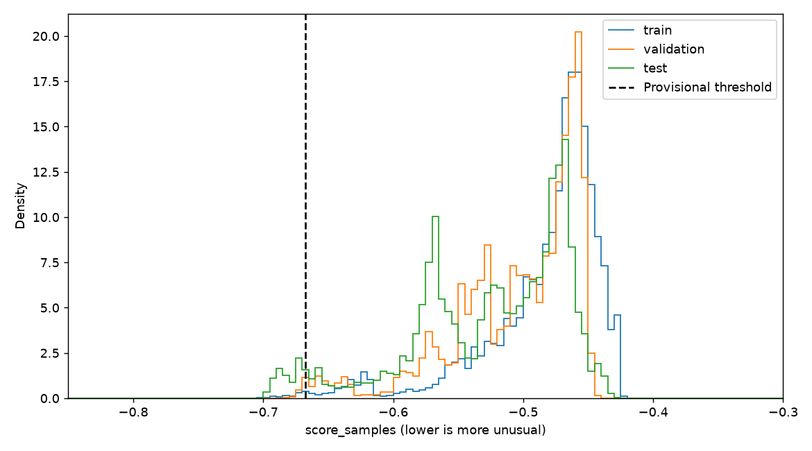
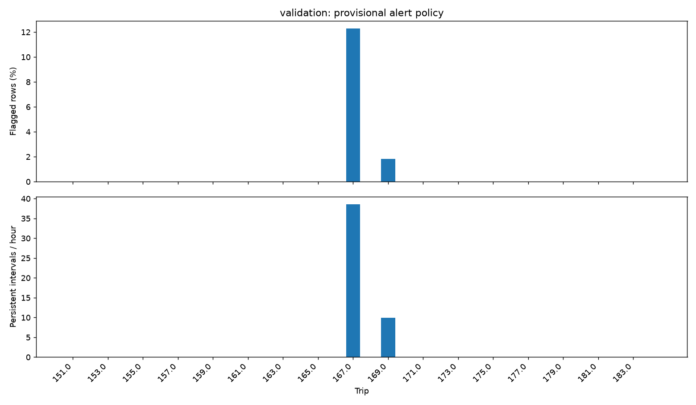
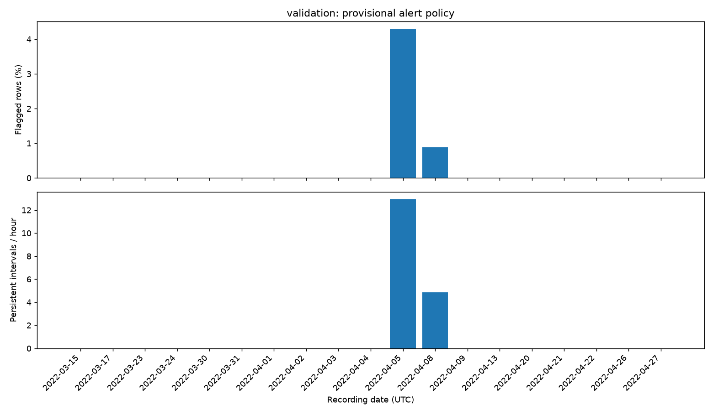
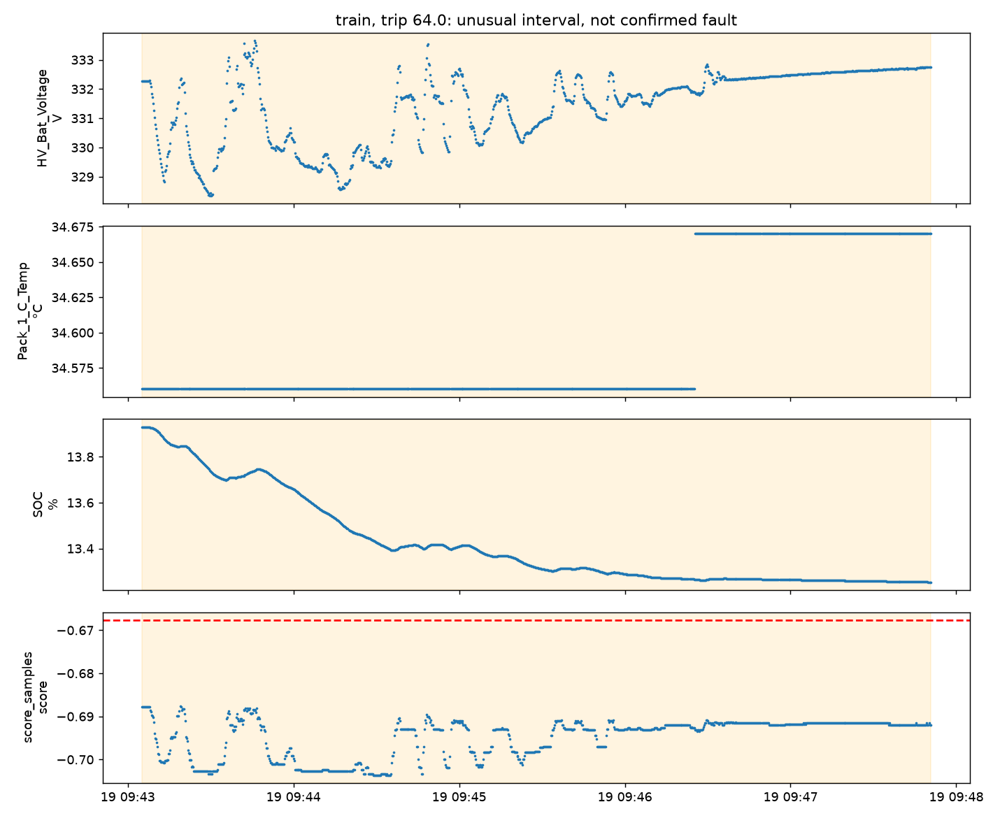
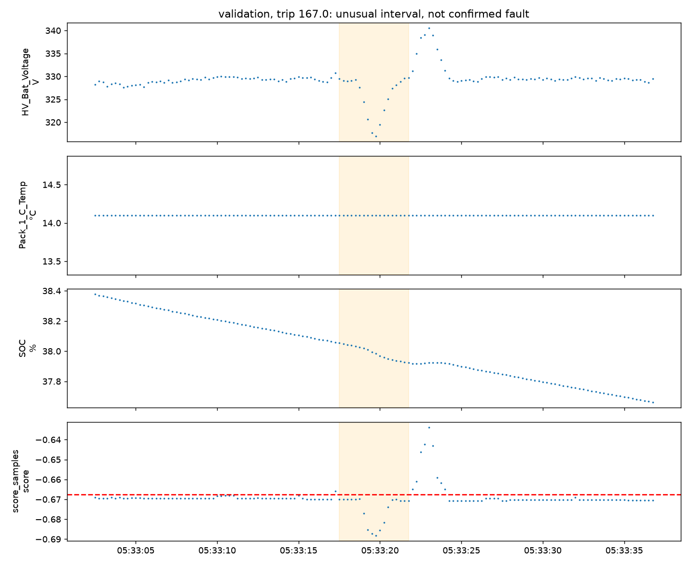
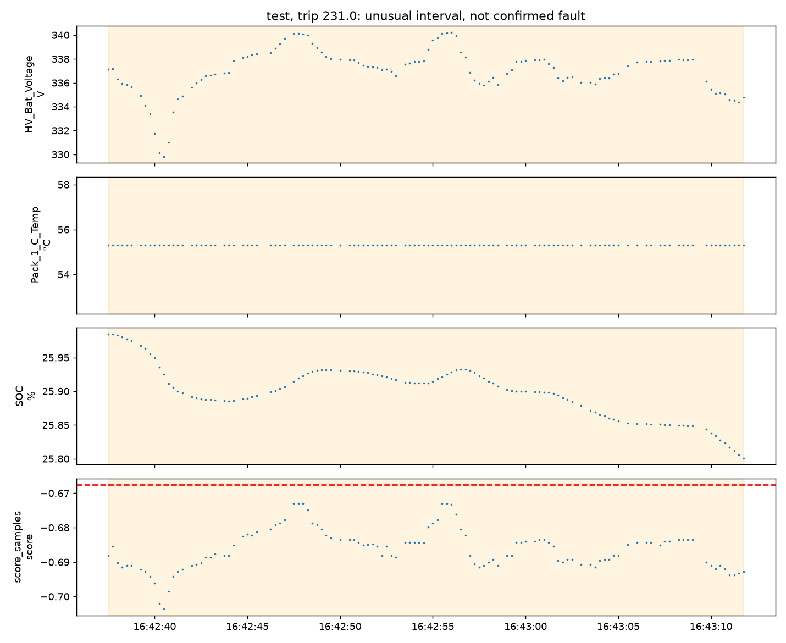

# Isolation Forest battery baseline

Purpose: identify statistically unusual logged battery telemetry, without diagnosing confirmed failures. Experiment `0c777345c64dfeba`; threshold **provisional**.

## 1. Objective

Train one lightweight unsupervised baseline. No artificial anomaly labels, fault-rate assumptions, supervised classification metrics, neural networks or application integration are used.

## 2. Dataset and preparation provenance

Input preparation: `1d6fc5b045ee25d0`, pinned manifest SHA-256 `55d15a5ab13a762bc5cacabcb4ea621fed1e8530a9d7319330e0d81513aeab80`. The source CSVs, workbook, preparation outputs and original six-feature artifacts were checksum-verified before and after execution. Prepared counts are verified from files and compared with the manifest: `{'test': 340986, 'train': 1623891, 'validation': 351087}`. Existing 142/34/51 trip memberships and preprocessing are unchanged; retained coverage differs from assigned trips.

See [EDA_REPORT.md](EDA_REPORT.md), [ML_READINESS_REPORT.md](ML_READINESS_REPORT.md), [DATA_PREPARATION_REPORT.md](DATA_PREPARATION_REPORT.md), [NEGATIVE_SPEED_REVIEW.md](NEGATIVE_SPEED_REVIEW.md) and [BATTERY_ONLY_PREPARATION_REPORT.md](BATTERY_ONLY_PREPARATION_REPORT.md). Test-period data-quality inspection already occurred. This test is exploratory held-out evaluation, not pristine independent confirmation.

## 3. Inputs and explanations

Exactly HV_Bat_Voltage, Pack_1_C_Temp, SOC, in that order. Already robust-scaled with frozen training medians/IQRs. No scaler is fitted here. IDs, timestamps and flags are audit metadata only. Every score includes exact logged feature values and training-IQR deviations. These deviations explain observed feature extremeness, **not causal reasons or exact isolation-tree contributions**.

## 4. Algorithm and score meaning

Isolation Forest repeatedly partitions randomly sampled observations using random feature thresholds. Points isolated in shorter paths receive more unusual scores. See [scikit-learn documentation](https://scikit-learn.org/stable/modules/generated/sklearn.ensemble.IsolationForest.html).

Lower `score_samples` means more unusual. `decision_function = score_samples - offset_`; with contamination='auto', offset is -0.5. Negative decision values refer to that default offset, not this experiment's review threshold. We export both scores, verify the formula against the API, and do not call predict. The operational flag is explicitly `score_samples < -0.6676090615628322`. Scores are not probabilities or mechanical risk percentages.

## 5. Training configuration

- n_estimators=200: number of randomized trees; a starting choice, not optimized.
- max_samples='auto': min(256, fitting rows) observations per tree.
- max_features=1.0: all three features available to each tree.
- bootstrap=False: without replacement within each tree's subsample.
- random_state=42: deterministic random draws.
- n_jobs=-1: available cores for fitting; scoring is batched without forced parallelism.
- contamination='auto': estimator offset convention only; the operational budget is separate.

Versions: `{'joblib': '1.5.3', 'numpy': '2.5.1', 'pandas': '2.3.3', 'pyarrow': '25.0.0', 'python': '3.12.13', 'sklearn': '1.9.0'}`. Fit runtime: **1.770s**. Model: **2,980,717 bytes**. Runtime is environment-dependent. No hyperparameter search occurred.

## 6. Fitting coverage and distributions

All **1,623,891** retained training rows, **139 trips**, **74 recording dates** were supplied to fit. No external sample was selected, so sample/full-training distribution differences are exactly zero. Per-tree subsampling is internal to Isolation Forest. Exact fit source row IDs, timestamps and trips are in fit_rows.parquet.

Long trips contribute more candidate rows; temporal autocorrelation and sensor refresh differences remain. Tree subsamples do not imply independent or healthy observations. [Scaled fitting distribution](./tables/isolation_forest/0c777345c64dfeba/fit_feature_distributions_scaled.csv) and [original-unit feature distributions](./tables/isolation_forest/0c777345c64dfeba/feature_distributions_original_units.csv) include ranges and percentiles.

## 7. Threshold strategy

Training-only lower quantiles at 0.1%, 0.5%, 1% define review-budget candidates. Strict '<' handles ties conservatively, so actual rates can differ. Validation checks alert volume, trip coverage and persistence, without fault labels. No labeled evidence or operator-capacity constraint establishes an optimal threshold, so the predeclared middle 0.5% budget remains **provisional**, not selected as best. Continuous scores are the primary output.

| split | training_budget | threshold | flagged_pct | persistent_alert_intervals | alerts_per_recorded_hour | trips_with_alerts |
| --- | --- | --- | --- | --- | --- | --- |
| train | 0.001 | -0.6892085480736216 | 0.0970508488562348 | 9 | 0.0741109763950122 | 1 |
| validation | 0.001 | -0.6892085480736216 | 0.0 | 0 | 0.0 | 0 |
| train | 0.005 | -0.6676090615628322 | 0.4993561759994975 | 60 | 0.4940731759667485 | 3 |
| validation | 0.005 | -0.6676090615628322 | 0.5289287270676499 | 49 | 1.942241715080991 | 2 |
| train | 0.01 | -0.6490654725804081 | 1.0000055422439067 | 101 | 0.8316898462106934 | 4 |
| validation | 0.01 | -0.6490654725804081 | 2.3207922822548257 | 92 | 3.646657914029616 | 2 |

All 0/2/5-second persistence comparisons are in [threshold_candidates.csv](./tables/isolation_forest/0c777345c64dfeba/threshold_candidates.csv); none uses test scores.

## 8. Time-aware aggregation

Consecutive flagged source rows only, same trip and preparation segment; break on unflagged rows, excluded source rows, nonpositive intervals or gaps >1s. No bridging through missing/excluded measurements. Event duration is last minus first observed timestamp, never row_count times assumed cadence. Single points have zero observed duration.

The predeclared 2s filter separates persistent review intervals from point/short candidates. It is a review convenience, not a physically validated fault duration. All point/short intervals and all row scores remain available. Complete interval tables retain source endpoints, timestamps, segment, trip, row count and min/mean/max score.

Recorded hours sum positive adjacent eligible-row intervals <=1s within the same segment/trip and consecutive source IDs. This is **eligible observed coverage**, not wall-clock vehicle use. Excluded periods and isolated points add no time. Date alert counts are assigned to event start dates; elapsed edges are assigned to their ending dates (a subsecond midnight edge may straddle dates).

## 9. Training diagnostics

| split | scored_rows | flagged_rows | flagged_pct | persistent_alert_intervals | recorded_hours | alerts_per_recorded_hour | trips_with_alerts |
| --- | --- | --- | --- | --- | --- | --- | --- |
| train | 1623891 | 8109 | 0.49935617599949755 | 60 | 121.43950110749999 | 0.49407317596674855 | 3 |

Fit/score runtimes, medians, ranges, coverage and model hashes are recorded in [experiment_summary.json](./tables/isolation_forest/0c777345c64dfeba/experiment_summary.json). All training data can include unknown faults or acquisition problems; this is not a known-healthy reference.

## 10. Validation diagnostics

| split | scored_rows | flagged_rows | flagged_pct | persistent_alert_intervals | recorded_hours | alerts_per_recorded_hour | trips_with_alerts |
| --- | --- | --- | --- | --- | --- | --- | --- |
| validation | 351087 | 1857 | 0.5289287270676499 | 49 | 25.22857974861111 | 1.942241715080991 | 2 |

Trip and date tables include zero-alert groups, scored counts, exposure hours, flagged percentages and score medians. Alert counts below mean persistent intervals; point candidates are recorded separately. An alert budget is not a false-positive rate.

## 11. Frozen test protocol

A single frozen test evaluation was performed after development.json and frozen_protocol.json were written and verified. A write-once receipt prevents another test evaluation in this experiment. No settings were revised from test scores.

| split | scored_rows | flagged_rows | flagged_pct | persistent_alert_intervals | recorded_hours | alerts_per_recorded_hour | trips_with_alerts |
| --- | --- | --- | --- | --- | --- | --- | --- |
| test | 340986 | 14041 | 4.117764365692434 | 152 | 26.786944722222223 | 5.674406005471093 | 5 |

Model and threshold hashes are verified before test loading. Source rows and trips are disjoint across splits and chronological boundaries are checked. The pipeline does not fit on validation or test, refit scaling, or introduce future input values. This same-vehicle time holdout limits generalization even with correct computational separation.

## 12. Score distributions



[Quantiles and first/second-half medians](./tables/isolation_forest/0c777345c64dfeba/score_stability.csv) describe temporal score shift. Same-seed refitting produced byte-identical model artifacts and identical scores on 4096 validation probe rows. Cross-seed robustness is **not assessed** in this single-configuration baseline.

## 13. Alert frequency and stability




Equivalent training/test plots are in the same figure directory. Trends can reflect state coverage, season, recording drift or acquisition quality. Date and trip variation is not evidence of deterioration or known faults.

## 14. Expert-review candidates

[Candidate intervals](./tables/isolation_forest/0c777345c64dfeba/expert_review_candidates.csv) lists at most 5 intervals per split, ordered by persistence, lowest score and timestamp. It includes voltage/temperature/SOC ranges and means, flags, drivetrain availability, score summaries and source/timestamp endpoints. Nearby scored telemetry within the same segment is saved as context_<split>_<rank>.parquet, extending up to 15.0s either side. These are review candidates, not verified faults.






## 15. Data-quality interactions

quality_<split>.csv stratifies scores and alert fractions by each preparation flag and suspected drivetrain unavailability, including absent groups. These flags are contextual evidence, never targets. Observed associations are confounded by trip/date/state and do not establish sensor failure. Eligibility already excluded some suspicious battery readings, which affects the score distribution and possible anomaly coverage.

## 16. Limitations

No verified fault labels, independent healthy control, repair outcomes or fleet sample exist. Fault accuracy, precision, recall, F1, F2 and ROC-AUC cannot be assigned. A single vehicle and temporally correlated rows constrain generalization. Sensor calibration, polling and sentinel conventions remain uncertain; stale data and legitimate operating extremes can appear unusual. The model sees pointwise voltage/temperature/SOC only, without current or operating-state history. Historical test inspection limits confirmatory claims. No production readiness is claimed.

## 17. Artifacts and reproducibility

Artifacts: `ml/artifacts/nissan_leaf_2018/isolation_forest/0c777345c64dfeba`. Fitted-model SHA-256: `93c7ef791fea49624de01fd1b39fa313e6305cdbb27fadeb0825e2d2c2ef4cef`. [Complete artifact inventory](./tables/isolation_forest/0c777345c64dfeba/artifact_inventory.csv) records sizes and hashes. Frozen protocol includes model/threshold/aggregation/configuration; identity includes Python/library versions, package code and input checksums. Score Parquets preserve row lineage and evidence compactly. Existing preparation outputs were never overwritten.

Same-seed model reconstruction and validation-probe comparison passed. Test was scored once, not repeatedly for reproduction. Runtime/UTC audit fields are intentionally nondeterministic. Unit tests and static-check results are recorded in [ISOLATION_FOREST_VALIDATION.md](ISOLATION_FOREST_VALIDATION.md). Load only trusted local joblib artifacts.

## 18. Reproduction commands

```bash
.venv/bin/python ml/notebooks/nissan_leaf_2018/scripts/train_isolation_forest.py --stage develop
.venv/bin/python ml/notebooks/nissan_leaf_2018/scripts/train_isolation_forest.py --stage test
MPLCONFIGDIR=/tmp/drivepulse-matplotlib .venv/bin/python ml/notebooks/nissan_leaf_2018/scripts/train_isolation_forest.py --stage report
.venv/bin/python -m pytest ml/tests -q
.venv/bin/ruff check ml/src/nissan_leaf_isolation ml/notebooks/nissan_leaf_2018/scripts/train_isolation_forest.py ml/tests
```

Execute stages in order in a clean workspace with the pinned preparation. Existing experiment directories are not overwritten; repeat test execution is refused. Identical-seed refitting is already performed within development for reproducibility. A new reviewed code/configuration identity produces a separate experiment, not permission to tune against test results.

## 19. Recommended next experiment

First review candidate intervals and validation alert burden with domain input; refine the provisional review policy using development data. Investigate causal past-only temporal features and operating-state context, with separate versioning and the same trip/gap controls. Do not jump to an autoencoder until baseline weaknesses and review criteria are understood. Battery temperature forecasting can proceed as a separate conditional experiment with a persistence reference, but it does not validate fault detection. None of these follow-on stages was implemented here.
