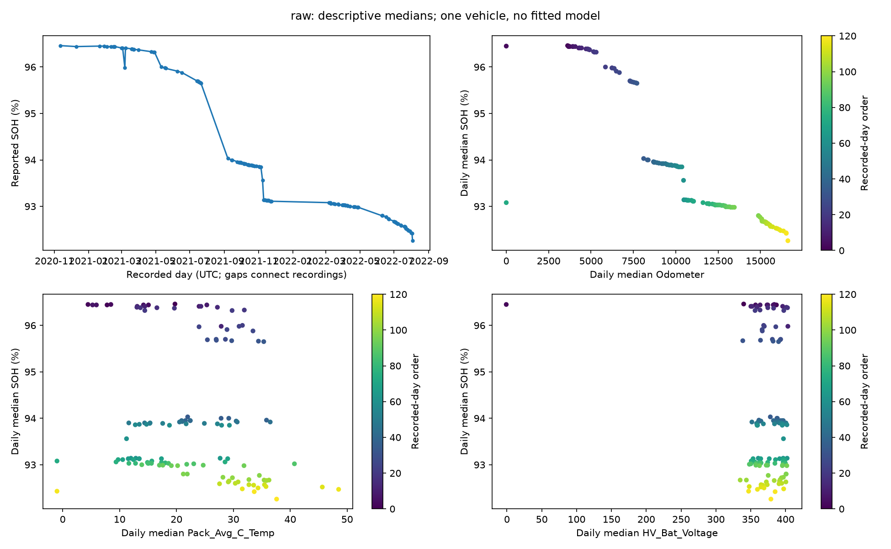
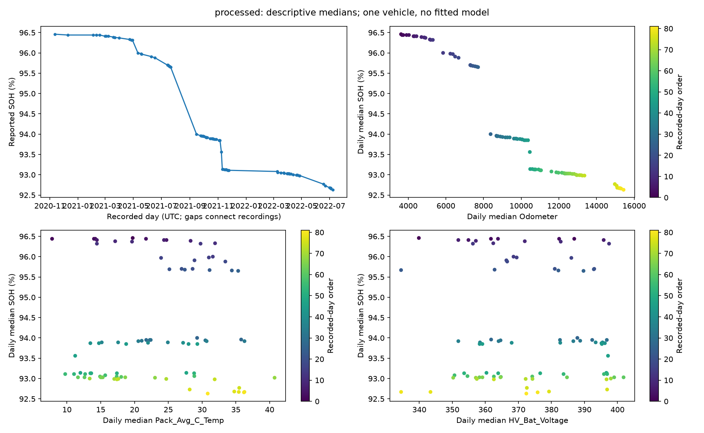

# Nissan Leaf 2018 — ML readiness assessment

Purpose: assess what existing evidence supports before model selection. No models, synthetic records, artificial fault labels, cleaning, imputation, scaling, engineered model features, or train/test splits were created. Analysis aggregates and differences are descriptive statistics only.

## 1. Executive summary

**Verified:** Both original CSVs match their acquisition SHA-256 checksums. Selected-column scans independently verify all row counts, time ordering, trip counts and three derived relationships. Existing complete EDA tables provide every-column schema, missingness, variability and distributions. Source files remain unchanged.

**Assessment:** This is a single-vehicle observational telemetry study, not a labeled diagnostic or run-to-failure dataset. Millions of readings do not provide millions of independent battery-health outcomes. Reported SOH can be displayed and monitored. Anomaly experiments and SOH prediction are conditional; fault classification and predictive maintenance lack essential outcomes. Experimental feasibility does not establish production readiness.

**Evidence labels:** “Verified” means observed in the files or explicit documentation. “Statistical observation” describes association without causation. “Hypothesis” requires independent confirmation. “Recommendation” specifies future work, not work performed here. “Unknown” means the available material does not settle it.

## 2. Verified dataset characteristics

| version | rows | columns | trip_ids | recorded_days | start_utc | end_utc |
| --- | --- | --- | --- | --- | --- | --- |
| raw | 2322105 | 92 | 227 | 121 | 2020-11-12 13:01:08.257560+00:00 | 2022-08-03 17:19:57.501000+00:00 |
| processed | 1918299 | 32 | 127 | 82 | 2020-11-12 13:01:08.757376+00:00 | 2022-07-08 17:55:20.001000+00:00 |


| version | missing_cells | exact_duplicate_rows | duplicate_timestamps |
| --- | --- | --- | --- |
| raw | 11595760 | 0 | 0 |
| processed | 0 | 0 | 0 |


Source: [official institutional dataset page](https://ubilab.mpu.edu.mo/data.html); local [source and usage findings](metadata/SOURCES.md), [download manifest](metadata/download_manifest.json), [parameter dictionary](metadata/parameter_dictionary_extracted.csv), [complete EDA](EDA_REPORT.md). No explicit open-data license was identified; citation request is not an unrestricted redistribution license.

Preprocessed storage: 32 numeric columns, semantically 3 identifiers, 1 timestamp, 2 categorical status fields and 26 other numeric columns (including derived values). Raw storage: 90 numeric and 2 text columns; semantic categories: 5 identifiers/export indices, 3 timestamp representations, 20 categorical statuses, 44 measured/undocumented numeric and 20 derived numeric fields. SOH is recorded telemetry and a possible task target, not a verified fault label. Seven processed Driver_ID codes do not establish seven vehicles. No VIN column is present. Published scope is one 2018 Leaf; independent vehicle generalization cannot be measured here.

The raw first CSV header is blank; pandas exposes it as `Unnamed: 0.1` alongside the literal `Unnamed: 0`. The inventory preserves both original and parsed names. No duplicate literal header names were found by the existing EDA. “Raw” already includes derived/calendar/accumulated fields and should not be assumed to be an untouched CAN capture.

## 3. Complete feature inventory

| version | entries | conditional_input_columns | potential_target_columns |
| --- | --- | --- | --- |
| processed | 32 | 28 | 10 |
| raw | 92 | 78 | 10 |


Counts are **source-column entries**, not unique selected features. “Conditional candidate” excludes identifiers, timestamps, wholly empty and constant fields; it is a deliberately broad review pool, not an approved input list. Odometer remains in that pool to make its shortcut risk explicit. The ten potential targets per version are recorded SOH plus nine possible future-telemetry quantities; none is a failure or maintenance target. Choice of horizon and target would change input eligibility. Unknown descriptions/units stay Unknown.

Complete machine-readable inventory: [feature_inventory.csv](tables/readiness/feature_inventory.csv). The following includes every source-column entry and its task-dependent caveats.

| source_dataset | column | dtype | description | unit | missing_pct | measurement_class | potential_input | potential_target | possible_target_leakage | redundancy | requires_investigation |
| --- | --- | --- | --- | --- | --- | --- | --- | --- | --- | --- | --- |
| raw | Unnamed: 0.1 | int64 | Unknown | Unknown | 0 | identifier_or_export_index | excluded_from_initial_input_pool | not_proposed | Recording identity/time/aging shortcut; use for grouping/context, not unrestricted health evidence | Not established; see EDA correlations | Incomplete documentation |
| raw | Unnamed: 0 | int64 | Unknown | Unknown | 0 | identifier_or_export_index | excluded_from_initial_input_pool | not_proposed | Recording identity/time/aging shortcut; use for grouping/context, not unrestricted health evidence | Not established; see EDA correlations | Incomplete documentation |
| raw | index | int64 | Unknown | Unknown | 0 | identifier_or_export_index | excluded_from_initial_input_pool | not_proposed | Recording identity/time/aging shortcut; use for grouping/context, not unrestricted health evidence | Not established; see EDA correlations | Incomplete documentation |
| raw | id | int64 | Unknown | Unknown | 0 | identifier_or_export_index | excluded_from_initial_input_pool | not_proposed | Recording identity/time/aging shortcut; use for grouping/context, not unrestricted health evidence | Not established; see EDA correlations | Incomplete documentation |
| raw | Timestamp | int64 | Unknown | Unknown | 0 | timestamp | excluded_from_initial_input_pool | not_proposed | Recording identity/time/aging shortcut; use for grouping/context, not unrestricted health evidence | Not established; see EDA correlations | Incomplete documentation |
| raw | DateTime | object | Unknown | Unknown | 0 | timestamp | excluded_from_initial_input_pool | not_proposed | Recording identity/time/aging shortcut; use for grouping/context, not unrestricted health evidence | Not established; see EDA correlations | Incomplete documentation |
| raw | Power_SW | int64 | This field will be True if Power Switch is ON otherwise it will be False | 0/1 | 0 | categorical_status | excluded_from_initial_input_pool | not_proposed | Exclude contemporaneous target and future information for any prediction task | Not established; see EDA correlations | At least 99% same nonmissing value |
| raw | Speed | float64 | Speed (km/h) from the Leaf ECU | km/h | 0 | measured_or_undocumented | conditional_candidate | future telemetry only; horizon must be defined | Exclude contemporaneous target and future information for any prediction task | Strong Speed/RPM correlation | Task availability and operating-state validation |
| raw | Odometer | float64 | Km total | km | 0 | measured_or_undocumented | conditional_candidate | not_proposed | Recording identity/time/aging shortcut; use for grouping/context, not unrestricted health evidence | Battery state/capacity proxies or shared aging trajectory; inspect task dependencies | See EDA quality, polarity, units or formula findings |
| raw | Gear | int64 | Gear position (0=not read yet, 1=Park, 2=Reverse, 3=Neutral, 4=Drive, 7=B/Eco) | see Info | 0 | categorical_status | conditional_candidate | not_proposed | Exclude contemporaneous target and future information for any prediction task | Not established; see EDA correlations | Task availability and operating-state validation |
| raw | RangeKm | int64 | Remaining km to turtle mode | km | 0 | measured_or_undocumented | conditional_candidate | not_proposed | Exclude contemporaneous target and future information for any prediction task | Not established; see EDA correlations | Task availability and operating-state validation |
| raw | SWA | float64 | Steering Wheel angle The angle ranges from -720 to 720 degrees with negative being left turn. | ° (360°) | 100 | measured_or_undocumented | excluded_from_initial_input_pool | not_proposed | Exclude contemporaneous target and future information for any prediction task | Not established; see EDA correlations | Missing observations |
| raw | RPM | int64 | Motor revolutions per minute | rev/min | 0 | measured_or_undocumented | conditional_candidate | not_proposed | Exclude contemporaneous target and future information for any prediction task | Strong Speed/RPM correlation | Task availability and operating-state validation |
| raw | GIDs | float64 | Gids which indicates the energy in the Leaf battery. Nissan multiplies this value by 80 Wh to get current capacity of the HV Battery | --- | 96.36485 | measured_or_undocumented | conditional_candidate | not_proposed | Exclude contemporaneous target and future information for any prediction task; possible direct SOH/capacity proxy; SOH cannot predict itself | Battery state/capacity proxies or shared aging trajectory; inspect task dependencies | Missing observations |
| raw | SOC | float64 | State of Charge (SOC) of the HV Battery | % | 0 | measured_or_undocumented | conditional_candidate | future telemetry only; horizon must be defined | Exclude contemporaneous target and future information for any prediction task | Battery state/capacity proxies or shared aging trajectory; inspect task dependencies | Task availability and operating-state validation |
| raw | SOH | float64 | State of Health is another indication of the battery's ability to hold and release energy and is reported as a percentage. When the battery is new SOH=100% | % | 0.09676565 | measured_or_undocumented | conditional_candidate | recorded SOH, not measured failure/capacity ground truth | Exclude contemporaneous target and future information for any prediction task; possible direct SOH/capacity proxy; SOH cannot predict itself | Battery state/capacity proxies or shared aging trajectory; inspect task dependencies | Missing observations |
| raw | AHr | float64 | Capacity of HV Battery. This is how much energy the battery could hold when fully charged. You can get an estimate of energy currently in the battery by multiplying SOC% times AHr times 360 volts (nominal HV battery voltage) = WHr | Ah | 0 | measured_or_undocumented | conditional_candidate | not_proposed | Exclude contemporaneous target and future information for any prediction task; possible direct SOH/capacity proxy; SOH cannot predict itself | Battery state/capacity proxies or shared aging trajectory; inspect task dependencies | Task availability and operating-state validation |
| raw | Hx | float64 | This is an indication of the HV Battery's health. A value of 100 would be a battery in factory new condition. The number is thought to be an indication of battery internal resistance with 100 indicating a new battery with lowest resistance. As the value decreases the internal resistance is increasing. As the internal resistance increases more energy is wasted as heat inside the battery instead of powering the Leaf | % | 0 | measured_or_undocumented | conditional_candidate | not_proposed | Exclude contemporaneous target and future information for any prediction task; possible direct SOH/capacity proxy; SOH cannot predict itself | Battery state/capacity proxies or shared aging trajectory; inspect task dependencies | Task availability and operating-state validation |
| raw | Rain_level | float64 | Rain sensitivity level for front wiper (automatic mode) (1: low, 4: high) | see Info | 0 | categorical_status | conditional_candidate | not_proposed | Exclude contemporaneous target and future information for any prediction task | Not established; see EDA correlations | Task availability and operating-state validation |
| raw | Front_wiper_level | float64 | -1: Off; 0: Automatic; 1: Continous slow speed; 2: Continous high speed | see Info | 0 | categorical_status | conditional_candidate | not_proposed | Exclude contemporaneous target and future information for any prediction task | Not established; see EDA correlations | Task availability and operating-state validation |
| raw | Rear_wiper_level | float64 | -1: Off; 1: Intermittent; 2: Continous low speed | see Info | 0 | categorical_status | excluded_from_initial_input_pool | not_proposed | Exclude contemporaneous target and future information for any prediction task | Not established; see EDA correlations | At least 99% same nonmissing value |
| raw | Front_washer | float64 | -1: Not active; 1: Active | see Info | 0 | categorical_status | conditional_candidate | not_proposed | Exclude contemporaneous target and future information for any prediction task | Not established; see EDA correlations | At least 99% same nonmissing value |
| raw | Rear_washer | float64 | -1: Not active; 1: Active | see Info | 0 | categorical_status | excluded_from_initial_input_pool | not_proposed | Exclude contemporaneous target and future information for any prediction task | Not established; see EDA correlations | At least 99% same nonmissing value |
| raw | Position_lights | int64 | -1: Off; 0: Automatic mode; 1: On | see Info | 0 | categorical_status | conditional_candidate | not_proposed | Exclude contemporaneous target and future information for any prediction task | Not established; see EDA correlations | Task availability and operating-state validation |
| raw | Headlights | int64 | -1: Off; 0: Automatic mode; 1: On | see Info | 0 | categorical_status | conditional_candidate | not_proposed | Exclude contemporaneous target and future information for any prediction task | Not established; see EDA correlations | Task availability and operating-state validation |
| raw | Anti_fog_lights | int64 | -1: Off; 1: On | see Info | 0 | categorical_status | conditional_candidate | not_proposed | Exclude contemporaneous target and future information for any prediction task | Not established; see EDA correlations | Task availability and operating-state validation |
| raw | HighBeam | int64 | -1: Off; 0: Automatic mode; 1: On; 2: Manual | see Info | 0 | categorical_status | conditional_candidate | not_proposed | Exclude contemporaneous target and future information for any prediction task | Not established; see EDA correlations | Task availability and operating-state validation |
| raw | Torque | float64 | Motor Torque. https://www.carwow.co.uk/guides/glossary/what-is-torque (Nm).  Minimum unit step is 0.25 Nm | Nm | 0 | measured_or_undocumented | conditional_candidate | not_proposed | Exclude contemporaneous target and future information for any prediction task | Not established; see EDA correlations | Task availability and operating-state validation |
| raw | Motor_Temp | int64 | This field is the drive motor temperature | °C | 0 | measured_or_undocumented | conditional_candidate | future telemetry only; horizon must be defined | Exclude contemporaneous target and future information for any prediction task | Not established; see EDA correlations | Task availability and operating-state validation |
| raw | Motor_Pwr | int64 | Drive motor power in watt units | W | 0 | measured_or_undocumented | conditional_candidate | not_proposed | Exclude contemporaneous target and future information for any prediction task | Not established; see EDA correlations | Task availability and operating-state validation |
| raw | TP_FR | float64 | Front right tire pressure (in kPa) | kPA | 0 | measured_or_undocumented | conditional_candidate | not_proposed | Exclude contemporaneous target and future information for any prediction task | Not established; see EDA correlations | Zero pressure may mean unavailable; verify |
| raw | TP_FL | float64 | Front left tire pressure (in kPa) | kPA | 0 | measured_or_undocumented | conditional_candidate | not_proposed | Exclude contemporaneous target and future information for any prediction task | Not established; see EDA correlations | Zero pressure may mean unavailable; verify |
| raw | TP_RR | float64 | Rear right tire pressure (in kPa) | kPA | 0 | measured_or_undocumented | conditional_candidate | not_proposed | Exclude contemporaneous target and future information for any prediction task | Not established; see EDA correlations | Zero pressure may mean unavailable; verify |
| raw | TP_RL | float64 | Rear left tire pressure (in kPa) | kPA | 0 | measured_or_undocumented | conditional_candidate | not_proposed | Exclude contemporaneous target and future information for any prediction task | Not established; see EDA correlations | Zero pressure may mean unavailable; verify |
| raw | Quick_Charge | float64 | Number of Quick Charges. Each time a Quick Charge occurs this number increments by 1 | --- | 0 | measured_or_undocumented | conditional_candidate | not_proposed | Exclude contemporaneous target and future information for any prediction task | Not established; see EDA correlations | Task availability and operating-state validation |
| raw | L1_L2_Charge | float64 | Number of L1/L2 connections and charges. This number increases each time the J1772 charge cord is plugged into the Leaf. It also increases by one for each delayed charge that takes place. If the Leaf charge timer is not active, so charging starts immediately when the charge cord is plugged in, then the count will increase by only one. But if the timer is active then the count will increase by two. Once when the charge cord is initially plugged in and a second time when the timer starts the delayed charge. | --- | 0 | measured_or_undocumented | conditional_candidate | not_proposed | Exclude contemporaneous target and future information for any prediction task | Not established; see EDA correlations | Task availability and operating-state validation |
| raw | Aux_Pwr_100W | int64 | Power used by the auxiliary equipment (Lights, Radio, Navigation system, rear defroster...) | W | 0 | measured_or_undocumented | conditional_candidate | not_proposed | Exclude contemporaneous target and future information for any prediction task | Not established; see EDA correlations | Task availability and operating-state validation |
| raw | AC_Pwr_250W | int64 | A/C system Power (250W): Power used by the Air Conditioning System power. This includes the power used by the cabin PTC Heater. A/C Compressure Air Pressure(0.1MPa): A/C Compressor high side pressure in Mpa. Multiply by 14.50377 to get PSI.  | W | 0 | measured_or_undocumented | conditional_candidate | not_proposed | Exclude contemporaneous target and future information for any prediction task | Not established; see EDA correlations | Task availability and operating-state validation |
| raw | AC_Compressor_Air_pressure | int64 | A/C system Power (250W): Power used by the Air Conditioning System power. This includes the power used by the cabin PTC Heater. A/C Compressure Air Pressure(0.1MPa): A/C Compressor high side pressure in Mpa. Multiply by 14.50377 to get PSI.  | MPa | 0 | measured_or_undocumented | conditional_candidate | not_proposed | Exclude contemporaneous target and future information for any prediction task | Not established; see EDA correlations | At least 99% same nonmissing value |
| raw | EstPwr_AC_50W | int64 | Estimated Air Conditioning System power (COOL) | W | 0 | measured_or_undocumented | conditional_candidate | not_proposed | Exclude contemporaneous target and future information for any prediction task | Not established; see EDA correlations | Task availability and operating-state validation |
| raw | EstPwr_Htr_250W | int64 | Estimated Cabin PTC Heater power (HEAT) | W | 0 | measured_or_undocumented | conditional_candidate | not_proposed | Exclude contemporaneous target and future information for any prediction task | Not established; see EDA correlations | Task availability and operating-state validation |
| raw | Plug_State | int64 | Plug state of J1772 (L1/L2) charge port ( 0=Not plugged, 1=Partial Plugged, 2=Plugged ) | see Info | 0 | categorical_status | conditional_candidate | not_proposed | Exclude contemporaneous target and future information for any prediction task | Not established; see EDA correlations | At least 99% same nonmissing value |
| raw | Charge_Mode | int64 | Charging mode. ( 0=Not charging, 1=Level 1 charging (100-120 volts), 2=Level 2 charging (200-240 volts),  3=Level 3 Quick Charging ) | see Info | 0 | categorical_status | conditional_candidate | not_proposed | Exclude contemporaneous target and future information for any prediction task | Not established; see EDA correlations | Task availability and operating-state validation |
| raw | OBC_Out_Pwr | int64 | Charging power coming into the Leaf in watts (W) | W | 0 | measured_or_undocumented | conditional_candidate | not_proposed | Exclude contemporaneous target and future information for any prediction task | Not established; see EDA correlations | Task availability and operating-state validation |
| raw | HV_Bat_Voltage | float64 | High Voltage Battery Voltage (in V) | V | 0 | measured_or_undocumented | conditional_candidate | future telemetry only; horizon must be defined | Exclude contemporaneous target and future information for any prediction task | Power=voltage*current/1000; horsepower=1.341*power; processed exceptions | See EDA quality, polarity, units or formula findings |
| raw | Insulation | float64 | Unknown | Unknown | 0 | measured_or_undocumented | conditional_candidate | not_proposed | Exclude contemporaneous target and future information for any prediction task | Not established; see EDA correlations | Incomplete documentation |
| raw | AC | int64 | Unknown | 0/1 | 0 | categorical_status | conditional_candidate | not_proposed | Exclude contemporaneous target and future information for any prediction task | Not established; see EDA correlations | Incomplete documentation |
| raw | RearHeater | int64 | Unknown | 0/1 | 0 | categorical_status | excluded_from_initial_input_pool | not_proposed | Exclude contemporaneous target and future information for any prediction task | Not established; see EDA correlations | Incomplete documentation; At least 99% same nonmissing value |
| raw | HeaterTemp | float64 | Heater temperature from 16.5°C to 30°C set by the driver | °C | 0.00030145062 | measured_or_undocumented | conditional_candidate | not_proposed | Exclude contemporaneous target and future information for any prediction task | Not established; see EDA correlations | Missing observations |
| raw | FanSpeed | float64 | Fan speed from 0 (off) to 8 (max) | 0-8 | 0 | categorical_status | conditional_candidate | not_proposed | Exclude contemporaneous target and future information for any prediction task | Not established; see EDA correlations | Task availability and operating-state validation |
| raw | Brake | int64 | Brake pression measured from 0 (not pressed) to 369 (max). Unit?? | Unknown | 0 | measured_or_undocumented | conditional_candidate | not_proposed | Exclude contemporaneous target and future information for any prediction task | Not established; see EDA correlations | Incomplete documentation |
| raw | Acc_Pedal | int64 | Acceleration pedal pression measured from 0 (not pressed) to 200 (max). Unit?? | Unknown | 0 | measured_or_undocumented | conditional_candidate | not_proposed | Exclude contemporaneous target and future information for any prediction task | Not established; see EDA correlations | Incomplete documentation |
| raw | ECO | int64 | ECO mode ON/OFF | 0/1 | 0 | categorical_status | conditional_candidate | not_proposed | Exclude contemporaneous target and future information for any prediction task | Not established; see EDA correlations | Task availability and operating-state validation |
| raw | ePedal | int64 | ePedal mode ON/OFF https://statics.quattroruote.it/content/dam/quattroruote/it/news/novita/2017/07/20/nuova_nissan_leaf_debutta_il_nuovo_e_pedal/gallery/rsmall/2017-epedal.jpg | 0/1 | 0 | categorical_status | conditional_candidate | not_proposed | Exclude contemporaneous target and future information for any prediction task | Not established; see EDA correlations | Task availability and operating-state validation |
| raw | Right_Arrow | float64 | -1: Off; 1: Active | see Info | 0 | categorical_status | conditional_candidate | not_proposed | Exclude contemporaneous target and future information for any prediction task | Not established; see EDA correlations | At least 99% same nonmissing value |
| raw | Left_Arrow | float64 | -1: Off; 1: Active | see Info | 0 | categorical_status | conditional_candidate | not_proposed | Exclude contemporaneous target and future information for any prediction task | Not established; see EDA correlations | At least 99% same nonmissing value |
| raw | HV_Bat_Current_1 | float64 | High Voltage Battery Amperage (positive=from battery (driving), negative when regeneration or charging) | A | 0 | measured_or_undocumented | conditional_candidate | not_proposed | Exclude contemporaneous target and future information for any prediction task | Not established; see EDA correlations | See EDA quality, polarity, units or formula findings |
| raw | HV_Bat_Current_2 | float64 | High Voltage Battery Amperage (positive=from battery (driving), negative when regeneration or charging) | A | 0 | measured_or_undocumented | conditional_candidate | future telemetry only; horizon must be defined | Exclude contemporaneous target and future information for any prediction task | Power=voltage*current/1000; horsepower=1.341*power; processed exceptions | See EDA quality, polarity, units or formula findings |
| raw | Bat_12V_Voltage | float64 | The voltage of the 12 volt battery as read by the Leaf's Vehicle Control Module ECU | V | 0 | measured_or_undocumented | conditional_candidate | not_proposed | Exclude contemporaneous target and future information for any prediction task | Not established; see EDA correlations | Task availability and operating-state validation |
| raw | Bat_12V_Current | float64 | 12 volt battery current. Minus is drain and positive is charging. | A | 0 | measured_or_undocumented | conditional_candidate | not_proposed | Exclude contemporaneous target and future information for any prediction task | Not established; see EDA correlations | Task availability and operating-state validation |
| raw | Ambient_C_Temp | float64 | Ambient temperature comes from the Leaf's outside temperature sensor and is saved in degrees Fahrenheit. This value is only valid when the Leaf is ON (not ACC mode and not when charging) | Unknown: workbook unit says °C; description says Fahrenheit | 0 | measured_or_undocumented | conditional_candidate | not_proposed | Exclude contemporaneous target and future information for any prediction task | Not established; see EDA correlations | See EDA quality, polarity, units or formula findings |
| raw | Internal_C_Temp | float64 | Unknown | Unknown | 67.621189 | measured_or_undocumented | conditional_candidate | not_proposed | Exclude contemporaneous target and future information for any prediction task | Not established; see EDA correlations | Incomplete documentation; Missing observations |
| raw | Pack_1_C_Temp | float64 | HV Battery temperature sensors (Pack_1_C_Temp, Pack_2_C_Temp, Pack_3_C_Temp, Pack_4_C_Temp). On Leaf 2018 40kW, Pack 3 is missing | °C | 0 | measured_or_undocumented | conditional_candidate | future telemetry only; horizon must be defined | Exclude contemporaneous target and future information for any prediction task | Pack mean derived from components 1/2/4; highly correlated | Task availability and operating-state validation |
| raw | Pack_2_C_Temp | float64 | HV Battery temperature sensors (Pack_1_C_Temp, Pack_2_C_Temp, Pack_3_C_Temp, Pack_4_C_Temp). On Leaf 2018 40kW, Pack 3 is missing | °C | 0 | measured_or_undocumented | conditional_candidate | future telemetry only; horizon must be defined | Exclude contemporaneous target and future information for any prediction task | Pack mean derived from components 1/2/4; highly correlated | Task availability and operating-state validation |
| raw | Pack_3_C_Temp | float64 | HV Battery temperature sensors (Pack_1_C_Temp, Pack_2_C_Temp, Pack_3_C_Temp, Pack_4_C_Temp). On Leaf 2018 40kW, Pack 3 is missing | °C | 100 | measured_or_undocumented | excluded_from_initial_input_pool | not_proposed | Exclude contemporaneous target and future information for any prediction task | Pack mean derived from components 1/2/4; highly correlated | Missing observations |
| raw | Pack_4_C_Temp | float64 | HV Battery temperature sensors (Pack_1_C_Temp, Pack_2_C_Temp, Pack_3_C_Temp, Pack_4_C_Temp). On Leaf 2018 40kW, Pack 3 is missing | °C | 0 | measured_or_undocumented | conditional_candidate | future telemetry only; horizon must be defined | Exclude contemporaneous target and future information for any prediction task | Pack mean derived from components 1/2/4; highly correlated | Task availability and operating-state validation |
| raw | CellMaxVolt | float64 | Unknown | Unknown | 67.618992 | measured_or_undocumented | conditional_candidate | not_proposed | Exclude contemporaneous target and future information for any prediction task | Not established; see EDA correlations | Incomplete documentation; Missing observations |
| raw | CellMinVolt | float64 | Unknown | Unknown | 67.618992 | measured_or_undocumented | conditional_candidate | not_proposed | Exclude contemporaneous target and future information for any prediction task | Not established; see EDA correlations | Incomplete documentation; Missing observations |
| raw | cDrvPkt | float64 | Unknown | Unknown | 0.021532187 | measured_or_undocumented | conditional_candidate | not_proposed | Exclude contemporaneous target and future information for any prediction task | Not established; see EDA correlations | Incomplete documentation; Missing observations |
| raw | cLoopPkt | float64 | Unknown | Unknown | 0.021532187 | measured_or_undocumented | conditional_candidate | not_proposed | Exclude contemporaneous target and future information for any prediction task | Not established; see EDA correlations | Incomplete documentation; Missing observations |
| raw | Pack_Avg_C_Temp | float64 | Unknown | Unknown | 0 | derived_numeric | conditional_candidate | future telemetry only; horizon must be defined | Exclude contemporaneous target and future information for any prediction task; audit formula and accumulation direction before use | Pack mean derived from components 1/2/4; highly correlated | Incomplete documentation; See EDA quality, polarity, units or formula findings; Formula, provenance and causal availability require review |
| raw | kWh_Remaining | float64 | Unknown | Unknown | 0 | derived_numeric | conditional_candidate | not_proposed | Exclude contemporaneous target and future information for any prediction task; audit formula and accumulation direction before use; possible direct SOH/capacity proxy; SOH cannot predict itself | Battery state/capacity proxies or shared aging trajectory; inspect task dependencies | Incomplete documentation; Formula, provenance and causal availability require review |
| raw | Horsepower | float64 | Derived from battery voltage × current, not a measured mechanical output | Unknown: formula gives 1.341 × kW | 0 | derived_numeric | conditional_candidate | not_proposed | Exclude contemporaneous target and future information for any prediction task; audit formula and accumulation direction before use | Power=voltage*current/1000; horsepower=1.341*power; processed exceptions | Formula, provenance and causal availability require review |
| raw | Instant_kW | float64 | Battery electrical power from voltage × current / 1000 | kW | 0 | derived_numeric | conditional_candidate | not_proposed | Exclude contemporaneous target and future information for any prediction task; audit formula and accumulation direction before use | Power=voltage*current/1000; horsepower=1.341*power; processed exceptions | See EDA quality, polarity, units or formula findings; Formula, provenance and causal availability require review |
| raw | Timestamp_Object | object | Unknown | Unknown | 0 | timestamp | excluded_from_initial_input_pool | not_proposed | Recording identity/time/aging shortcut; use for grouping/context, not unrestricted health evidence | Not established; see EDA correlations | Incomplete documentation |
| raw | Trip | int64 | Unknown | Unknown | 0 | identifier_or_export_index | excluded_from_initial_input_pool | not_proposed | Recording identity/time/aging shortcut; use for grouping/context, not unrestricted health evidence | Not established; see EDA correlations | Incomplete documentation |
| raw | Odometer_diff | float64 | Unknown | Unknown | 0 | derived_numeric | conditional_candidate | not_proposed | Exclude contemporaneous target and future information for any prediction task; audit formula and accumulation direction before use | Not established; see EDA correlations | Incomplete documentation; At least 99% same nonmissing value; Formula, provenance and causal availability require review |
| raw | accu_Speed | float64 | Unknown | Unknown | 0 | derived_numeric | conditional_candidate | not_proposed | Exclude contemporaneous target and future information for any prediction task; audit formula and accumulation direction before use | Not established; see EDA correlations | Incomplete documentation; Formula, provenance and causal availability require review |
| raw | accu_Brake | int64 | Unknown | Unknown | 0 | derived_numeric | conditional_candidate | not_proposed | Exclude contemporaneous target and future information for any prediction task; audit formula and accumulation direction before use | Not established; see EDA correlations | Incomplete documentation; Formula, provenance and causal availability require review |
| raw | accu_HV_Bat_Current_2 | float64 | Unknown | Unknown | 0 | derived_numeric | conditional_candidate | not_proposed | Exclude contemporaneous target and future information for any prediction task; audit formula and accumulation direction before use | Not established; see EDA correlations | Incomplete documentation; Formula, provenance and causal availability require review |
| raw | accu_Torque | float64 | Unknown | Unknown | 0 | derived_numeric | conditional_candidate | not_proposed | Exclude contemporaneous target and future information for any prediction task; audit formula and accumulation direction before use | Not established; see EDA correlations | Incomplete documentation; Formula, provenance and causal availability require review |
| raw | accu_Motor_Pwr | int64 | Unknown | Unknown | 0 | derived_numeric | conditional_candidate | not_proposed | Exclude contemporaneous target and future information for any prediction task; audit formula and accumulation direction before use | Not established; see EDA correlations | Incomplete documentation; Formula, provenance and causal availability require review |
| raw | accu_Acc_Pedal | int64 | Unknown | Unknown | 0 | derived_numeric | conditional_candidate | not_proposed | Exclude contemporaneous target and future information for any prediction task; audit formula and accumulation direction before use | Not established; see EDA correlations | Incomplete documentation; Formula, provenance and causal availability require review |
| raw | accu_Horsepower | float64 | Unknown | Unknown | 0 | derived_numeric | conditional_candidate | not_proposed | Exclude contemporaneous target and future information for any prediction task; audit formula and accumulation direction before use | Not established; see EDA correlations | Incomplete documentation; Formula, provenance and causal availability require review |
| raw | accu_Instant_kW | float64 | Unknown | Unknown | 0 | derived_numeric | conditional_candidate | not_proposed | Exclude contemporaneous target and future information for any prediction task; audit formula and accumulation direction before use | Not established; see EDA correlations | Incomplete documentation; Formula, provenance and causal availability require review |
| raw | accu_Odometer_diff | float64 | Unknown | Unknown | 0 | derived_numeric | conditional_candidate | not_proposed | Exclude contemporaneous target and future information for any prediction task; audit formula and accumulation direction before use | Not established; see EDA correlations | Incomplete documentation; Formula, provenance and causal availability require review |
| raw | Day sin | float64 | Unknown | Unknown | 0 | derived_numeric | conditional_candidate | not_proposed | Exclude contemporaneous target and future information for any prediction task; audit formula and accumulation direction before use | Not established; see EDA correlations | Incomplete documentation; Formula, provenance and causal availability require review |
| raw | Day cos | float64 | Unknown | Unknown | 0 | derived_numeric | conditional_candidate | not_proposed | Exclude contemporaneous target and future information for any prediction task; audit formula and accumulation direction before use | Not established; see EDA correlations | Incomplete documentation; Formula, provenance and causal availability require review |
| raw | Season sin | float64 | Unknown | Unknown | 0 | derived_numeric | conditional_candidate | not_proposed | Exclude contemporaneous target and future information for any prediction task; audit formula and accumulation direction before use | Not established; see EDA correlations | Incomplete documentation; Formula, provenance and causal availability require review |
| raw | Season cos | float64 | Unknown | Unknown | 0 | derived_numeric | conditional_candidate | not_proposed | Exclude contemporaneous target and future information for any prediction task; audit formula and accumulation direction before use | Not established; see EDA correlations | Incomplete documentation; Formula, provenance and causal availability require review |
| raw | Year sin | float64 | Unknown | Unknown | 0 | derived_numeric | conditional_candidate | not_proposed | Exclude contemporaneous target and future information for any prediction task; audit formula and accumulation direction before use | Not established; see EDA correlations | Incomplete documentation; Formula, provenance and causal availability require review |
| raw | Year cos | float64 | Unknown | Unknown | 0 | derived_numeric | conditional_candidate | not_proposed | Exclude contemporaneous target and future information for any prediction task; audit formula and accumulation direction before use | Not established; see EDA correlations | Incomplete documentation; Formula, provenance and causal availability require review |
| processed | index | int64 | Unknown | Unknown | 0 | identifier_or_export_index | excluded_from_initial_input_pool | not_proposed | Recording identity/time/aging shortcut; use for grouping/context, not unrestricted health evidence | Not established; see EDA correlations | Incomplete documentation |
| processed | Timestamp | int64 | Unknown | Unknown | 0 | timestamp | excluded_from_initial_input_pool | not_proposed | Recording identity/time/aging shortcut; use for grouping/context, not unrestricted health evidence | Not established; see EDA correlations | Incomplete documentation |
| processed | Speed | float64 | Speed (km/h) from the Leaf ECU | km/h | 0 | measured_or_undocumented | conditional_candidate | future telemetry only; horizon must be defined | Exclude contemporaneous target and future information for any prediction task | Strong Speed/RPM correlation | Task availability and operating-state validation |
| processed | Odometer | float64 | Km total | km | 0 | measured_or_undocumented | conditional_candidate | not_proposed | Recording identity/time/aging shortcut; use for grouping/context, not unrestricted health evidence | Battery state/capacity proxies or shared aging trajectory; inspect task dependencies | See EDA quality, polarity, units or formula findings |
| processed | RPM | float64 | Motor revolutions per minute | rev/min | 0 | measured_or_undocumented | conditional_candidate | not_proposed | Exclude contemporaneous target and future information for any prediction task | Strong Speed/RPM correlation | Task availability and operating-state validation |
| processed | SOC | float64 | State of Charge (SOC) of the HV Battery | % | 0 | measured_or_undocumented | conditional_candidate | future telemetry only; horizon must be defined | Exclude contemporaneous target and future information for any prediction task | Battery state/capacity proxies or shared aging trajectory; inspect task dependencies | Task availability and operating-state validation |
| processed | SOH | float64 | State of Health is another indication of the battery's ability to hold and release energy and is reported as a percentage. When the battery is new SOH=100% | % | 0 | measured_or_undocumented | conditional_candidate | recorded SOH, not measured failure/capacity ground truth | Exclude contemporaneous target and future information for any prediction task; possible direct SOH/capacity proxy; SOH cannot predict itself | Battery state/capacity proxies or shared aging trajectory; inspect task dependencies | Task availability and operating-state validation |
| processed | Torque | float64 | Motor Torque. https://www.carwow.co.uk/guides/glossary/what-is-torque (Nm).  Minimum unit step is 0.25 Nm | Nm | 0 | measured_or_undocumented | conditional_candidate | not_proposed | Exclude contemporaneous target and future information for any prediction task | Not established; see EDA correlations | Task availability and operating-state validation |
| processed | Motor_Temp | float64 | This field is the drive motor temperature | °C | 0 | measured_or_undocumented | conditional_candidate | future telemetry only; horizon must be defined | Exclude contemporaneous target and future information for any prediction task | Not established; see EDA correlations | Task availability and operating-state validation |
| processed | TP_FR | float64 | Front right tire pressure (in kPa) | kPA | 0 | measured_or_undocumented | conditional_candidate | not_proposed | Exclude contemporaneous target and future information for any prediction task | Not established; see EDA correlations | Zero pressure may mean unavailable; verify |
| processed | TP_FL | float64 | Front left tire pressure (in kPa) | kPA | 0 | measured_or_undocumented | conditional_candidate | not_proposed | Exclude contemporaneous target and future information for any prediction task | Not established; see EDA correlations | Zero pressure may mean unavailable; verify |
| processed | TP_RR | float64 | Rear right tire pressure (in kPa) | kPA | 0 | measured_or_undocumented | conditional_candidate | not_proposed | Exclude contemporaneous target and future information for any prediction task | Not established; see EDA correlations | Zero pressure may mean unavailable; verify |
| processed | TP_RL | float64 | Rear left tire pressure (in kPa) | kPA | 0 | measured_or_undocumented | conditional_candidate | not_proposed | Exclude contemporaneous target and future information for any prediction task | Not established; see EDA correlations | Zero pressure may mean unavailable; verify |
| processed | Aux_Pwr_100W | float64 | Power used by the auxiliary equipment (Lights, Radio, Navigation system, rear defroster...) | W | 0 | measured_or_undocumented | conditional_candidate | not_proposed | Exclude contemporaneous target and future information for any prediction task | Not established; see EDA correlations | Task availability and operating-state validation |
| processed | AC_Pwr_250W | float64 | A/C system Power (250W): Power used by the Air Conditioning System power. This includes the power used by the cabin PTC Heater. A/C Compressure Air Pressure(0.1MPa): A/C Compressor high side pressure in Mpa. Multiply by 14.50377 to get PSI.  | W | 0 | measured_or_undocumented | conditional_candidate | not_proposed | Exclude contemporaneous target and future information for any prediction task | Not established; see EDA correlations | Task availability and operating-state validation |
| processed | EstPwr_AC_50W | float64 | Estimated Air Conditioning System power (COOL) | W | 0 | measured_or_undocumented | conditional_candidate | not_proposed | Exclude contemporaneous target and future information for any prediction task | Not established; see EDA correlations | Task availability and operating-state validation |
| processed | HV_Bat_Voltage | float64 | High Voltage Battery Voltage (in V) | V | 0 | measured_or_undocumented | conditional_candidate | future telemetry only; horizon must be defined | Exclude contemporaneous target and future information for any prediction task | Power=voltage*current/1000; horsepower=1.341*power; processed exceptions | See EDA quality, polarity, units or formula findings |
| processed | Brake | float64 | Brake pression measured from 0 (not pressed) to 369 (max). Unit?? | Unknown | 0 | measured_or_undocumented | conditional_candidate | not_proposed | Exclude contemporaneous target and future information for any prediction task | Not established; see EDA correlations | Incomplete documentation |
| processed | Acc_Pedal | float64 | Acceleration pedal pression measured from 0 (not pressed) to 200 (max). Unit?? | Unknown | 0 | measured_or_undocumented | conditional_candidate | not_proposed | Exclude contemporaneous target and future information for any prediction task | Not established; see EDA correlations | Incomplete documentation |
| processed | ECO | float64 | ECO mode ON/OFF | 0/1 | 0 | categorical_status | conditional_candidate | not_proposed | Exclude contemporaneous target and future information for any prediction task | Not established; see EDA correlations | Task availability and operating-state validation |
| processed | ePedal | float64 | ePedal mode ON/OFF https://statics.quattroruote.it/content/dam/quattroruote/it/news/novita/2017/07/20/nuova_nissan_leaf_debutta_il_nuovo_e_pedal/gallery/rsmall/2017-epedal.jpg | 0/1 | 0 | categorical_status | conditional_candidate | not_proposed | Exclude contemporaneous target and future information for any prediction task | Not established; see EDA correlations | Task availability and operating-state validation |
| processed | HV_Bat_Current_2 | float64 | High Voltage Battery Amperage (positive=from battery (driving), negative when regeneration or charging) | A | 0 | measured_or_undocumented | conditional_candidate | future telemetry only; horizon must be defined | Exclude contemporaneous target and future information for any prediction task | Power=voltage*current/1000; horsepower=1.341*power; processed exceptions | See EDA quality, polarity, units or formula findings |
| processed | Ambient_C_Temp | float64 | Ambient temperature comes from the Leaf's outside temperature sensor and is saved in degrees Fahrenheit. This value is only valid when the Leaf is ON (not ACC mode and not when charging) | Unknown: workbook unit says °C; description says Fahrenheit | 0 | measured_or_undocumented | conditional_candidate | not_proposed | Exclude contemporaneous target and future information for any prediction task | Not established; see EDA correlations | See EDA quality, polarity, units or formula findings |
| processed | Pack_1_C_Temp | float64 | HV Battery temperature sensors (Pack_1_C_Temp, Pack_2_C_Temp, Pack_3_C_Temp, Pack_4_C_Temp). On Leaf 2018 40kW, Pack 3 is missing | °C | 0 | measured_or_undocumented | conditional_candidate | future telemetry only; horizon must be defined | Exclude contemporaneous target and future information for any prediction task | Pack mean derived from components 1/2/4; highly correlated | Task availability and operating-state validation |
| processed | Pack_2_C_Temp | float64 | HV Battery temperature sensors (Pack_1_C_Temp, Pack_2_C_Temp, Pack_3_C_Temp, Pack_4_C_Temp). On Leaf 2018 40kW, Pack 3 is missing | °C | 0 | measured_or_undocumented | conditional_candidate | future telemetry only; horizon must be defined | Exclude contemporaneous target and future information for any prediction task | Pack mean derived from components 1/2/4; highly correlated | Task availability and operating-state validation |
| processed | Pack_4_C_Temp | float64 | HV Battery temperature sensors (Pack_1_C_Temp, Pack_2_C_Temp, Pack_3_C_Temp, Pack_4_C_Temp). On Leaf 2018 40kW, Pack 3 is missing | °C | 0 | measured_or_undocumented | conditional_candidate | future telemetry only; horizon must be defined | Exclude contemporaneous target and future information for any prediction task | Pack mean derived from components 1/2/4; highly correlated | Task availability and operating-state validation |
| processed | Pack_Avg_C_Temp | float64 | Unknown | Unknown | 0 | derived_numeric | conditional_candidate | future telemetry only; horizon must be defined | Exclude contemporaneous target and future information for any prediction task; audit formula and accumulation direction before use | Pack mean derived from components 1/2/4; highly correlated | Incomplete documentation; See EDA quality, polarity, units or formula findings; Formula, provenance and causal availability require review |
| processed | kWh_Remaining | float64 | Unknown | Unknown | 0 | derived_numeric | conditional_candidate | not_proposed | Exclude contemporaneous target and future information for any prediction task; audit formula and accumulation direction before use; possible direct SOH/capacity proxy; SOH cannot predict itself | Battery state/capacity proxies or shared aging trajectory; inspect task dependencies | Incomplete documentation; Formula, provenance and causal availability require review |
| processed | Horsepower | float64 | Derived from battery voltage × current, not a measured mechanical output | Unknown: formula gives 1.341 × kW | 0 | derived_numeric | conditional_candidate | not_proposed | Exclude contemporaneous target and future information for any prediction task; audit formula and accumulation direction before use | Power=voltage*current/1000; horsepower=1.341*power; processed exceptions | Formula, provenance and causal availability require review |
| processed | Instant_kW | float64 | Battery electrical power from voltage × current / 1000 | kW | 0 | derived_numeric | conditional_candidate | not_proposed | Exclude contemporaneous target and future information for any prediction task; audit formula and accumulation direction before use | Power=voltage*current/1000; horsepower=1.341*power; processed exceptions | See EDA quality, polarity, units or formula findings; Formula, provenance and causal availability require review |
| processed | Driver_ID | int64 | Unknown | Unknown | 0 | identifier_or_export_index | excluded_from_initial_input_pool | not_proposed | Recording identity/time/aging shortcut; use for grouping/context, not unrestricted health evidence | Not established; see EDA correlations | Incomplete documentation |
| processed | Trip | int64 | Unknown | Unknown | 0 | identifier_or_export_index | excluded_from_initial_input_pool | not_proposed | Recording identity/time/aging shortcut; use for grouping/context, not unrestricted health evidence | Not established; see EDA correlations | Incomplete documentation |


## 4. SOH and battery degradation findings

| version | soh_min | soh_max | soh_unique | soh_first | soh_last | soh_missing | soh_zero | soh_outside_0_100 | soh_on_0_01_grid_fraction | soh_increases_all_adjacent | soh_decreases_all_adjacent | soh_increases_within_trip | soh_decreases_within_trip | soh_equal_within_trip_pct | trips_with_soh_changes | daily_median_soh_increases |
| --- | --- | --- | --- | --- | --- | --- | --- | --- | --- | --- | --- | --- | --- | --- | --- | --- |
| raw | 0 | 96.46 | 84 | 96.46 | 92.12 | 2247 | 2853 | 0 | 1 | 147 | 227 | 142 | 151 | 99.987369 | 8 | 2 |
| processed | 92.63 | 96.46 | 56 | 96.46 | 92.63 | 0 | 0 | 0 | 1 | 184 | 239 | 183 | 186 | 99.980763 | 2 | 0 |


Counts of increases/decreases use adjacent source rows with finite reported values, separated into within-trip and all-adjacent comparisons; they are not counts of physical battery recovery/degradation events. `soh_on_0_01_grid_fraction` measures proximity to a 0.01 percentage-point grid at absolute tolerance 1e-7 after multiplying by 100. Value frequencies and every observed transition are saved in `tables/readiness/*_soh_values.csv` and `*_soh_changes.csv`. Trip ranges and daily medians are in `*_trip_soh.csv` and `*_daily_soh.csv`.

**Documentation:** The workbook associates SOH with ECU `0x79B (LBC)`, the Li-ion battery controller. This supports calling it controller/BMS-reported SOH, not laboratory-measured remaining capacity. SOH polling frequency is undocumented. Repeated telemetry values cannot reveal the controller's internal estimation/update schedule.

**Interpretation:** Use the observed unique values, near-complete adjacent equality and changing-trip counts above to assess effective outcome diversity. These readings behave much more like slowly changing vehicle state than independent labels per row. Temporary upward steps are observed where the increase counts are positive; calibration, operating conditions and estimator behavior are plausible hypotheses, not established causes. The data cannot distinguish estimator recalibration from true capacity change.

**Important range correction:** The often-quoted 92.63–96.46% range applies only to the processed file. Raw contains 2,853 zero readings, 2,247 missing readings and positive values down to 92.12%. Zero readings are suspicious in this context, not confirmed zero remaining battery health. They remain in the all-row descriptive calculations. Raw has 84 distinct nonmissing values (83 positive); processed has 56. All nonmissing values lie on a 0.01-point grid. This supports quantized reporting, but not a known periodic update schedule.

Processed SOH changes are confined to Trip 77 (93.89–93.96%) and Trip 195 (92.67–92.68%). Its 183 within-trip upward steps coexist with zero increases in recorded-day median SOH: local oscillation is not evidence of long-term recovery. Raw has 142 within-trip increases and two increases between recorded-day medians. The two exports cannot be assumed to preserve identical update behavior: existing matched-row checks find 128 changed finite SOH values and 2,201 raw-missing SOH values present in the processed counterpart.

AHr, Hx and GIDs are battery capacity/health/energy proxies in the raw documentation. kWh_Remaining depends on SOC and capacity assumptions; those fields could shortcut a SOH task. Do not present SOH-from-SOH or a capacity-proxy reconstruction as independent battery diagnosis. No capacity-test truth was found. A focused raw formula audit tests `kWh_Remaining = SOC * AHr * 0.0036` (percent SOC, Ah and nominal 360 V): {'compared_rows': 2322105, 'mismatches_atol_rtol_1e_8': 0}. This verifies or rejects that numerical relationship without proving independently measured energy or capacity. Raw row-level correlations with AHr/Hx/GIDs are included in the association table; GIDs has 96.36% missingness, so its pairwise subset is highly selected.





## 5. Mileage shortcut investigation

The following uses Pearson correlations; the complete table also contains Spearman rank correlations and within-month daily comparisons. All rows are retained, with pairwise nonmissing finite values contributing to each correlation; daily/trip medians give equal weight to recorded days/trips. No statistical significance tests assuming independent rows, regression fits or models were used.

| version | level | variable | method | paired_count | correlation |
| --- | --- | --- | --- | --- | --- |
| processed | telemetry_rows | Odometer | pearson | 1918299 | -0.95080593 |
| processed | telemetry_rows | Timestamp | pearson | 1918299 | -0.93387369 |
| processed | telemetry_rows | SOC | pearson | 1918299 | -0.059868721 |
| processed | telemetry_rows | Pack_Avg_C_Temp | pearson | 1918299 | 0.041713912 |
| processed | telemetry_rows | HV_Bat_Voltage | pearson | 1918299 | -0.036541034 |
| processed | telemetry_rows | HV_Bat_Current_2 | pearson | 1918299 | 0.018578687 |
| processed | trip_medians | Odometer | pearson | 127 | -0.94617375 |
| processed | trip_medians | Timestamp | pearson | 127 | -0.93305409 |
| processed | trip_medians | SOC | pearson | 127 | 0.027158297 |
| processed | trip_medians | Pack_Avg_C_Temp | pearson | 127 | 0.017967407 |
| processed | trip_medians | HV_Bat_Voltage | pearson | 127 | -0.017690471 |
| processed | trip_medians | HV_Bat_Current_2 | pearson | 127 | -0.019155202 |
| processed | recorded_day_medians | Odometer | pearson | 82 | -0.94888949 |
| processed | recorded_day_medians | Timestamp | pearson | 82 | -0.93331575 |
| processed | recorded_day_medians | SOC | pearson | 82 | -0.063600503 |
| processed | recorded_day_medians | Pack_Avg_C_Temp | pearson | 82 | 0.080329993 |
| processed | recorded_day_medians | HV_Bat_Voltage | pearson | 82 | -0.061580635 |
| processed | recorded_day_medians | HV_Bat_Current_2 | pearson | 82 | -0.057806793 |
| processed | successive_recorded_day_differences | Odometer | pearson | 81 | -0.40834345 |
| processed | successive_recorded_day_differences | Timestamp | pearson | 81 | -0.39317725 |
| processed | successive_recorded_day_differences | SOC | pearson | 81 | -0.02367743 |
| processed | successive_recorded_day_differences | Pack_Avg_C_Temp | pearson | 81 | 0.10757237 |
| processed | successive_recorded_day_differences | HV_Bat_Voltage | pearson | 81 | -0.042780346 |
| processed | successive_recorded_day_differences | HV_Bat_Current_2 | pearson | 81 | -0.038429867 |
| raw | telemetry_rows | Odometer | pearson | 2319858 | -0.019781656 |
| raw | telemetry_rows | Timestamp | pearson | 2319858 | -0.32801676 |
| raw | telemetry_rows | SOC | pearson | 2319858 | -0.0036378978 |
| raw | telemetry_rows | Pack_Avg_C_Temp | pearson | 2319858 | -0.029559489 |
| raw | telemetry_rows | HV_Bat_Voltage | pearson | 2319858 | -0.0052714835 |
| raw | telemetry_rows | HV_Bat_Current_2 | pearson | 2319858 | 0.0054590083 |
| raw | telemetry_rows | AHr | pearson | 2319858 | 0.13763739 |
| raw | telemetry_rows | Hx | pearson | 2319858 | 0.28179195 |
| raw | telemetry_rows | GIDs | pearson | 84412 | -0.27380735 |
| raw | trip_medians | Odometer | pearson | 227 | -0.915954 |
| raw | trip_medians | Timestamp | pearson | 227 | -0.93723041 |
| raw | trip_medians | SOC | pearson | 227 | -0.017619762 |
| raw | trip_medians | Pack_Avg_C_Temp | pearson | 227 | -0.23524211 |
| raw | trip_medians | HV_Bat_Voltage | pearson | 227 | -0.1431667 |
| raw | trip_medians | HV_Bat_Current_2 | pearson | 227 | -0.015866405 |
| raw | recorded_day_medians | Odometer | pearson | 121 | -0.90190432 |
| raw | recorded_day_medians | Timestamp | pearson | 121 | -0.94349203 |
| raw | recorded_day_medians | SOC | pearson | 121 | -0.10079055 |
| raw | recorded_day_medians | Pack_Avg_C_Temp | pearson | 121 | -0.17949503 |
| raw | recorded_day_medians | HV_Bat_Voltage | pearson | 121 | -0.16679568 |
| raw | recorded_day_medians | HV_Bat_Current_2 | pearson | 121 | -0.0060292409 |
| raw | successive_recorded_day_differences | Odometer | pearson | 120 | -0.070364239 |
| raw | successive_recorded_day_differences | Timestamp | pearson | 120 | -0.35192808 |
| raw | successive_recorded_day_differences | SOC | pearson | 120 | -0.01707364 |
| raw | successive_recorded_day_differences | Pack_Avg_C_Temp | pearson | 120 | 0.09906457 |
| raw | successive_recorded_day_differences | HV_Bat_Voltage | pearson | 120 | -0.024938172 |
| raw | successive_recorded_day_differences | HV_Bat_Current_2 | pearson | 120 | -0.089823604 |


Raw odometer–time correlation: rows **0.063165**, recorded-day medians **0.947874**. Preprocessed: rows **0.990880**, recorded-day medians **0.990594**.

**Statistical observation:** Compare the SOH–odometer and SOH–time associations above against temperature, SOC, voltage and current. Successive-recorded-day differences remove a shared level trend, but unequal calendar gaps remain; these are not per-day degradation rates. Within-month results can have very small samples or constant SOH (undefined correlations are blank). None of these comparisons identifies a causal aging mechanism or proves how a future model will behave.

**Observed sensitivity:** Processed SOH–odometer Pearson r is -0.950806 across rows and -0.948889 across 82 recorded-day medians; SOH–time is -0.933874 and -0.933316 respectively. Daily temperature r is only +0.080330. Successive-day SOH-change versus odometer-change correlation is -0.408343, much weaker than the level relationship. Thus shared time progression is a strong competing explanation, although the descriptive analysis does not isolate a causal contribution of mileage.

Raw all-row Pearson results are severely sensitive to suspect values: odometer spans -1 to 16,763,904 km, and SOH includes zeros. Its SOH–odometer Pearson r is -0.019782 while Spearman is -0.992200; daily-median Pearson is -0.901904. Raw SOH–time Pearson is -0.328017 versus Spearman -0.993081. This large contrast is a data-quality sensitivity finding, not evidence that mileage has no relationship with SOH. No readings were deleted to improve correlations. Aggregates/ranks reduce some extreme-value influence but do not validate those values.

**Hypothesis:** Mileage can encode this vehicle's recording/aging trajectory. Strong level correlations alone can reward memorizing date/mileage and reported SOH updates. Daily aggregation reduces duration weighting but does not create independent vehicles. The table quantifies the risk; it does not prove universal mileage-based battery degradation. Temperature also co-varies with season and use. Odometer discontinuities complicate causal interpretation.

**Recommendation:** Future evaluation must compare performance with and without identity/time/mileage and capacity proxies, and against simple observed-SOH persistence and time/mileage-only reference predictions. Those experiments have not been run. Independent vehicles and capacity measurements are necessary before claiming generalizable battery-health estimation.

## 6. Anomaly detection readiness

**Conditionally ready — further verification required.** The data can characterize observed telemetry, but absence of fault labels does not certify a healthy training reference. Scores would indicate unusualness relative to recorded operating conditions, not confirmed defects or fault probabilities.

Candidate groups for later review: battery electrical (voltage, current, SOC); thermal (pack components, motor temperature, ambient after unit resolution); drivetrain (speed or RPM, torque, pedals/brake); auxiliary loads (AC and auxiliary power); contextual states (ECO/ePedal; raw gear/charge status after code and polling review). Do not blindly combine every group or count correlated channels as independent evidence. Tire pressure needs zero-value interpretation first. SOH is a slow contextual signal, not a dense fault label.

Raw all-empty fields: SWA, Pack_3_C_Temp. Raw constant fields: Power_SW, Rear_wiper_level, Rear_washer, RearHeater. Raw near-constant fields: Power_SW, Rear_wiper_level, Front_washer, Rear_washer, AC_Compressor_Air_pressure, Plug_State, RearHeater, Right_Arrow, Left_Arrow, Odometer_diff. The preprocessed data have no constant or >=99% dominant columns under the EDA definition. Complete variability, nonmissing cardinalities and IQR outlier counts are in the existing per-version `summary_statistics.csv`, `column_dictionary.csv` and `measurement_updates.csv`.

Verified redundancy includes processed Speed/RPM r≈0.99958, current/power r≈0.98941, SOC/kWh_Remaining r≈0.99101, closely correlated pack temperatures, and exact horsepower/power proportionality. These associations include shared operating state and formulas. Large torque/current excursions can be acceleration or regeneration; IQR flags do not diagnose faults.

Stationary speed identifies stopped observations, not necessarily idle or charging. Raw Charge_Mode has only -1 (605,817 observations, undocumented unknown state) and 0 (1,716,288, documented not charging); documented active codes 1/2/3 are absent. Plug/gear readings poll slowly and can be stale. Negative current alone cannot establish charging because documented polarity conflicts with much observed moving telemetry. No verified charging-session coverage can be claimed.

Raw data are needed to inspect original extreme/sentinel readings, statuses and missingness. The preprocessed data contain changed values and formula inconsistencies, so they cannot be presumed a clean normal-reference set. Neither version constitutes an independent validation set for the other.

## 7. Fault classification readiness

**Not ready — essential evidence missing.** Inspection of all columns, workbook descriptions and existing source documentation found no verified healthy/faulty target, DTC sequence, confirmed battery/sensor/charging/motor failure, repair record or event-adjudication table. The word health in SOH/Hx does not supply a fault class. Gear, charging and driver codes are not diagnostic labels.

A suspicious value may be a sensor/polling problem, a preprocessing artifact, a valid extreme or an unknown state. These alternatives cannot be converted into supervised labels from this evidence. Needed: independently confirmed diagnostic categories and event times, workshop/DTC evidence, normal comparison intervals, sensor/calibration context, enough independent events per category, and held-out vehicles. Both supervised training and diagnostic accuracy validation would otherwise lack defensible ground truth.

## 8. Battery health estimation readiness

**Monitoring the reported SOH: Ready for controlled experimentation.** Display controller-reported SOH, date and provenance; summarize its trend with gaps and uncertainty visible. This does not need a learned estimator.

**Estimating current or forecasting future reported SOH: Conditionally ready — further verification required.** A recorded target exists, but its low update rate, limited range, single-vehicle trajectory and strong age proxies make trivial shortcuts plausible. Current SOH estimation must withhold SOH itself and inspect AHr/Hx/remaining-energy dependencies. Forecasting requires a defined horizon, strictly past information and enough observed future outcomes; missing weeks are not measured degradation paths. Using past reported SOH can be legitimate for forecasting, but must be disclosed and compared with persistence.

**Independent physical battery-health or capacity estimation: Not ready — essential evidence missing.** The controller label alone cannot validate true capacity or generalization to another battery. Need independent capacity/resistance testing under known conditions, vehicle/battery identity and firmware, and multiple independently followed vehicles. No end-of-life trajectory or failure threshold is established.

## 9. Predictive maintenance readiness

**Not ready — essential evidence missing.** No failure timestamps, repair dates, component replacements, verified service needs, known end-of-life outcomes or event-linked fleet histories were found. AHr and SOH provide reported battery estimates, not a controlled capacity-test history. Intermittent telemetry and absent verified active charging coverage do not establish complete usage/charging history.

- Future telemetry prediction means forecasting an observed signal at a defined horizon; it may support a controlled descriptive forecasting experiment after continuity review.
- SOH forecasting predicts future controller-reported state; it is not equivalent to a failure forecast.
- Component-failure prediction needs confirmed outcomes and time-at-risk, which are absent.
- Remaining useful life needs an explicit end-of-life definition and observed/censored lifetimes; a short SOH trend cannot supply them.
- Maintenance recommendations need validated links from evidence to service need, inspection/repair outcomes and intervention policy; unusual readings alone do not establish these links.

## 10. Temporal structure and leakage risks

| version | timestamp_parse_failures | global_reversals | trip_blocks | reused_noncontiguous_trip_ids | within_trip_reversals | within_trip_gaps_gt_1s | within_trip_gaps_gt_5s | within_trip_gaps_gt_60s | median_within_trip_positive_interval_s |
| --- | --- | --- | --- | --- | --- | --- | --- | --- | --- |
| raw | 0 | 0 | 227 | 0 | 0 | 15825 | 2973 | 358 | 0.25 |
| processed | 0 | 0 | 127 | 0 | 0 | 7984 | 2142 | 184 | 0.25 |


Trip-ID overlap between versions: **127 shared**, **100 raw-only**, **0 processed-only**. All 1,886,696 matched timestamp rows also retain the same Trip ID according to the existing value comparison. The source-order block checks above test ID reuse; existing session tables show whether trip ranges overlap and their full measurement-sequence hash screens. Those screens found no identical complete sequences; they cannot exclude partial or near-duplicate recordings. IDs are useful recording groups, but undocumented segmentation rules prevent assuming each equals one complete physical journey. Seven Driver_ID codes are contextual identities, not independent vehicle replications.

Epoch timestamps are microseconds; parsing checks above use UTC as a representation, not a claim about the original recorder's local timezone. Raw DateTime has fractional-second strings; Timestamp_Object truncates to seconds and is unsuitable for distinguishing all rows. Both files are chronologically ordered under the checks above. A median 0.25-second row cadence does not mean every sensor polls at 4 Hz: the workbook also documents 1-, 10- and 100-second channels. Adjacent-similarity results are in [adjacent_similarity.csv](tables/readiness/adjacent_similarity.csv), restricted to same-trip positive intervals <=1 second.

**Why random row splits mislead:** Adjacent rows often carry the same slow sensor or SOH reading. Random assignment puts nearly identical states from one trip on both sides, exposes future aging states, and can split overlapping windows. Duplicate or derived information and shared raw/processed records add further leakage. Millions of rows cannot fix this dependence.

**Recommended future protocol (no splits created):** Choose a task/horizon first. Reserve a later chronological block containing entire trip groups for final evaluation, with earlier whole-trip blocks for development and validation. Move boundaries to prevent any trip, shared raw/processed timestamp or overlapping input/target window crossing partitions. Apply a purge interval at least as large as the longest input lookback plus prediction horizon where windows could overlap; choose it after sensor and dependence review. Never bridge trip boundaries, nonpositive time steps or task-inappropriate gaps. The 1/5/60-second gap counts here are sensitivity descriptions, not an approved universal threshold. Fit all preprocessing on development-training data only. Report metrics by trip/day, time horizon and operating state, with effective outcome counts. Do not claim cross-vehicle validation.

Chronological splitting alone can cut a trip. Trip-grouped random splitting controls shared-trip leakage but still mixes future/past aging states. Chronology with whole-trip boundaries is the defensible primary protocol here; future independent-vehicle holdout is required for transfer claims. Calendar/accumulated fields must be audited for future-inclusive calculations. Target-specific leakage includes power's voltage/current formula, pack mean's component temperatures, SOC-derived remaining energy and SOH/capacity proxies.

## 11. Preprocessing requirements — documentation only

| version | relationship | compared_rows | mismatches | max_abs_error |
| --- | --- | --- | --- | --- |
| raw | Instant_kW_from_VI | 2322105 | 0 | 2.8421709e-14 |
| raw | Horsepower_from_Instant_kW | 2322105 | 0 | 5.6843419e-14 |
| raw | Pack_Avg_from_1_2_4 | 2322105 | 0 | 7.1054274e-15 |
| processed | Instant_kW_from_VI | 1918299 | 30057 | 121.06626 |
| processed | Horsepower_from_Instant_kW | 1918299 | 0 | 4.2632564e-14 |
| processed | Pack_Avg_from_1_2_4 | 1918299 | 1395 | 4.7333333 |


Derived checks compare finite values with atol=rtol=1e-8; discrepancies are verified numerical inconsistencies, not confirmed hardware defects. Raw satisfies all three formulas, while processed changes break two of them. Do not overwrite either source or silently recompute away evidence.

Existing EDA also identifies two zero and one >500 V processed voltage readings (a review screen, not a manufacturer-certified validity limit), 321 within-trip odometer decreases and 304 jumps >1 km within <=1 second, and roughly 197k–202k zeros per tire-pressure channel. Their causes remain unresolved. Current sign and ambient-temperature documentation need clarification. Workbook units for Brake/Acc_Pedal are unknown. Some raw -1 codes are documented statuses and cannot be blanket-imputed.

| Requirement | Reason and future decision needed |
|---|---|
| Missingness | Raw has extensive missing fields; all-empty columns carry no signal. Processed has no NaNs but can retain placeholders. Establish per-sensor semantics before any imputation; fit any learned values on training only. |
| Invalid/nonfinite values | Reuse full EDA finite counts and range screens; distinguish impossible values from undocumented codes. Preserve exclusion reasons and source references. |
| Outliers | Inspect state and temporal context; statistical extremes may be legitimate acceleration/regeneration. Do not automatically remove. |
| Duplicates | No exact duplicates were found; held sensor values are normal with asynchronous polling. Avoid collapsing them without a sampling policy. |
| Units/sign | Resolve current polarity, ambient temperature and pedal/brake definitions; power-unit suffixes may describe resolution rather than stored-value multipliers. |
| Polling/time gaps | Define per-channel update/hold behavior, alignment policy and window validity; no sequences across excluded boundaries. |
| Derived/redundant fields | Decide task-specific inclusion after verifying formulas, information availability and target dependencies. |
| Categorical status | Preserve documented meanings and unknown states; numeric codes do not imply an ordered physical scale. |
| Scaling | Assess whether the eventually selected method needs it; mixed units/ranges can dominate distance-based comparisons. Estimate any scaling parameters on training data only. No scaler chosen/fitted here. |
| Identity and time | Keep for grouping/auditing; test shortcuts explicitly, avoid export indices as sensor inputs. |
| Reference selection | Define what is typical by observed state without inventing healthy labels; retain uncertain intervals for review. |

## 12. Four-task readiness comparison

| Task | Readiness | Intended output | Targets available | Prototype | Real-world validation |
| --- | --- | --- | --- | --- | --- |
| A — Anomaly detection | Conditionally ready — further verification required | Unusual telemetry relative to observed operating context | No verified normal/fault reference | Yes, after unit/sign/formula and reference-set review | No; needs adjudicated events and independent vehicles |
| B — Fault classification | Not ready — essential evidence missing | Specific confirmed fault category | No verified fault categories or DTC outcomes | No evidence-based supervised fault experiment from this dataset alone | No; needs diagnostic labels, normal controls, event times and independent vehicles |
| C — Battery health estimation | Conditionally ready — further verification required | Reported-SOH monitoring; exploratory estimation/forecasting | LBC-reported SOH, not independently measured capacity | Monitoring ready for controlled experimentation; prediction conditional | No general battery-health claim; needs independent capacity tests and vehicles |
| D — Predictive maintenance | Not ready — essential evidence missing | Future failure, service requirement or remaining life | No failure/service/end-of-life outcomes | No validated maintenance prediction; telemetry forecasting is a separate task | No; needs longitudinal event-linked fleet histories |


Potential inputs are the reviewed groups in section 6 and the full inventory. Every task inherits single-vehicle generalization limits, asynchronous sampling and raw/processed provenance uncertainty. SOH additionally risks time/mileage/capacity shortcuts; anomaly experiments risk learning preprocessing artifacts; fault and maintenance tasks cannot overcome missing outcomes through feature selection.

## 13. Dataset limitations and raw versus processed provenance

Verified alignment: 1,886,696 shared exact timestamps with matching exported indices, 435,409 raw-only timestamps and 31,603 processed-only timestamps. Processed-only observations span 63 trip IDs. Counts do not establish that preprocessing created records: export/version differences remain an alternative. The preprocessed file is not a strict subset. Matched values change in several channels, including power and temperature, while matched odometer values are unchanged. See [timestamp alignment](tables/raw_processed_timestamp_alignment.json), [matched values](tables/raw_processed_matched_values.csv), [retained versus removed](tables/retained_vs_removed_raw_rows.csv) and [distribution comparison](tables/raw_processed_distributions.csv).

The existing distribution comparisons establish altered coverage/values, not the researchers' exact cleaning pipeline. Unusual raw observations may be absent or altered, but without preprocessing code/provenance there is no complete causal explanation. This assessment does not reproduce that pipeline. Seasonal/route/driver selection, intermittent recording, narrow SOH range, one vehicle and missing diagnostic/service outcomes limit transfer. No unobserved intervals were filled.

## 14. Recommended next investigations

1. Ask the researchers for preprocessing code/version provenance, processed-only records, current polarity, unit ambiguities, trip segmentation and SOH update definitions. Resolve usage rights before redistribution.
2. Review formula-discrepant rows and voltage/odometer/tire-zero cases against original adjacent records and documented operating context; record adjudication without inventing fault labels.
3. Decide whether the prototype is a reported-SOH monitor or a conditional unusual-telemetry experiment; state the limits in its outputs. Define target horizon and available-at-inference inputs before prediction work.
4. Approve per-channel missing/code/unit/polling and gap policies, then a chronological whole-trip evaluation protocol. Recheck capacity-proxy and calendar/accumulated dependencies. Do not split until these decisions are explicit.
5. Only in a separately authorized experiment, test shortcut sensitivity and simple temporal reference predictions. Gather independent vehicles and capacity measurements for battery-health validation.
6. Obtain event-linked diagnosis, service and end-of-life data before fault classification, failure forecasting, RUL or maintenance claims.

## 15. Unanswered questions and reproducibility

Unknown: why processed-only timestamps exist; exact preprocessing operations; sign convention actually used in the logger; ambient-temperature unit discrepancy; zero-pressure meaning; causes of voltage/odometer artifacts; whether aggregated fields include future data; physical trip definition; SOH estimator firmware/update cadence/calibration; independent battery capacity truth; complete charging history; diagnostic/maintenance outcomes; redistribution rights. No additional external records were acquired in this assessment.

Reproduce from the repository root (uses the existing environment; pandas/NumPy/Matplotlib plus SciPy for Spearman correlations):

```bash
MPLCONFIGDIR=/tmp/drivepulse-matplotlib .venv/bin/python ml/notebooks/nissan_leaf_2018/scripts/readiness.py
.venv/bin/python -m pytest ml/tests/test_nissan_leaf_readiness.py -q
.venv/bin/ruff check ml/notebooks/nissan_leaf_2018/scripts/readiness.py ml/notebooks/nissan_leaf_2018/scripts/readiness_report.py ml/tests/test_nissan_leaf_readiness.py
```

The script hashes original source files, checks schemas/counts, scans 14 shared selected columns plus four raw capacity/energy columns sequentially per version, reuses full EDA statistics, writes every inventory entry, and produces descriptive tables and two figures. The selected frames occupy roughly 215–334 MB before working copies; the run does not load all 92 raw columns. Unit tests use small original-file excerpts and lightweight outputs, never full telemetry scans. Tests exercise schema rejection, ordering, trip boundaries, missing accounting, formulas, inventory completeness and report/manifest consistency. Test execution results are recorded separately in `READINESS_VALIDATION.md`.

The [readiness manifest](readiness_manifest.json) records source checksums, reused EDA table hashes, script hashes, library versions and all generated output hashes. No new fault labels, training data or final partitions are outputs. Existing [EDA output index](OUTPUT_INDEX.md) remains the guide to the prior analysis.
